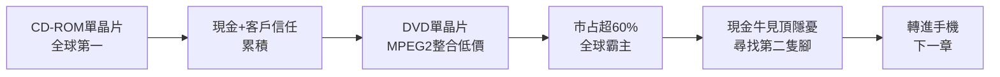

# 2.2 CD-ROM 與 DVD 晶片稱霸全球（1999-2001）

## 從台灣第一到世界第一

1999-2000 年，聯發科 CD-ROM 控制晶片市占率衝上全球第一，超過飛利浦、三洋等日歐大廠。秘訣是速度：當競爭者還在推半年一改版時，聯發科以三個月一改版、直接派駐工程師進駐客戶工廠（On-site Support）解決問題，黏住光碟機廠。

緊接著 DVD 播放機起飛。DVD 技術門檻更高，涉及 MPEG-2 解碼、抖動容忍、區碼等。聯發科 1999 年底推出 DVD 單晶片方案，將前端伺服與後端解碼整合，價格僅為日系方案一半。台灣、大陸 DVD 整機廠如雨後春筍，幾乎全用聯發科，市占率一度超過 60-70%，「聯發科裡面就是一台 DVD」的說法不脛而走。

## 定價權與現金牛

光儲存晶片毛利率高、周轉快，聯發科 2000 年前後營收、獲利三級跳，成為新竹園區最賺錢的 IC 設計公司。充沛現金使其能大舉招募、投入下一代手機晶片預研，而不必向市場伸手。這是典型的「現金牛哺育明星產品」策略。

但隱憂已現：光儲存是 PC 依附型市場，天花板有限；DVD 價格戰遲早重演 CD-ROM 故事。蔡明介在巔峰時即要求團隊尋找「第二隻腳」，目光投向手機基頻——一個比 DVD 大十倍的市場。

## 因果鏈

**前因驅動：** 前節的整合方法論＋台灣光碟機產業鏈 clustering（群聚），互相驅動：聯發科越便宜，整機廠越多；整機廠越多，聯發科量越大、成本越低，飛輪加速。

**後果引發：** 光儲存霸業帶來兩個後果：一是 2001 年上市的底氣與高估值；二是讓蔡明介確信「落後市場＋整合低價＋在地服務」可以打敗日歐巨頭，這套信念被整套搬到手機 Turnkey 戰場，成就更大的顛覆。
