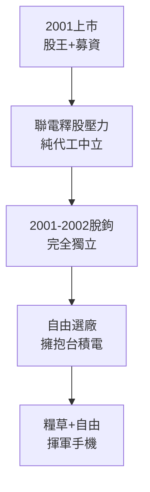

# 2.3 上市與聯電釋股獨立（2001-2003）

## 2001 年掛牌上市

2001 年 7 月，聯發科在台灣證交所掛牌（2454），正值網路泡沫破裂、台股低迷之際，卻以光儲存霸主的高獲利 stmt 取得市場青睞，股價一度成為 IC 設計股王。上市募資進一步充實銀彈，為手機晶片研發提供數年不虞匱乏的糧草。

上市的另一意義是治理透明化：財報、法說會迫使聯發科建立與國際投資人溝通的能力，這對日後與高通對陣時爭取外資認同至關重要。

## 聯電釋股：被迫的獨立

2001-2002 年，聯電為徹底落實純代工、消除客戶疑慮，並因應公平會與市場對「球員兼裁判」的批評，陸續釋出聯發科持股。2001 年底聯發科正式與聯電脫鉤，成為完全獨立的 Fabless 公司。此後聯發科可自由向台積電下單，不再被綁定聯電產能——這在 2000 年代台積電製程領先拉開時，成為生死攸關的自由。

釋股短期造成股價波動，但長期是解放：聯發科得以建立自己的供應鏈策略，在台積電、聯電之間比價議價，並與封測、IP 廠商結盟。蔡明介的領導也從「集團子公司總經理」轉為「獨立上市公司董事長」，決策更為果斷。

> 獨立性價值可用選擇權定價直覺理解： $V_{indep} = V_{bound} + Option(自由選廠)$ ，當台積電與聯電製程差距 $\Delta$ 擴大時，選擇權價值暴增。

## 因果鏈

**前因驅動：** 光儲存霸業（高獲利）使上市水到渠成；聯電純代工戰略的貫徹則迫使釋股——前者是實力，後者是制度，兩者合力完成獨立。

**後果引發：** 獨立後的資金與供應鏈自由，是 2003-2004 年敢於投入手機基頻（需長期虧損研發）的前提。若仍是聯電之子，既無巨額現金自主權，也無自由轉單台積電先進製程的空間，手機戰役未戰先敗。
