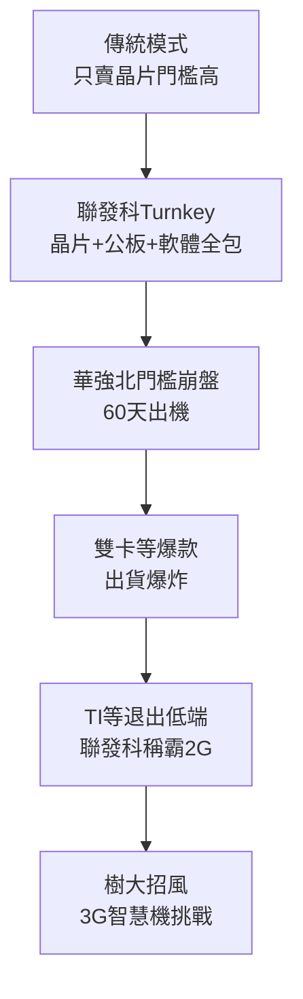

# 3.2 Turnkey 交鑰匙顛覆華強北（2005-2008）

## 什麼是交鑰匙？

傳統手機晶片廠只賣晶片與底層驅動，整機廠需自行開發主機板、軟體、相機調校、天線，門檻極高。聯發科 2005 年前後推出「Turnkey Solution（交鑰匙方案）」：晶片＋公板（Reference Design）＋作業軟體（MAUI 平台）＋多媒體應用＋測試調校，一站式交付。客戶拿到方案，換個外殼、加顆電池，60 天即可出貨。

這把手機製造門檻從「千人研發、億元投入」降到「數十人、百萬元」。深圳華強北無數中小廠、甚至個體戶蜂擁而入，雙卡雙待、大喇叭、手寫、跑馬燈等「山寨機」特色功能，皆由聯發科平台快速支撐。2006-2008 年聯發科手機晶片出貨量爆炸性成長，大陸市占率一度超過五成，營收翻倍，股價再登股王。

## 為何巨頭學不來？

TI、飛利浦並非做不出 Turnkey，而是不願做：其商業模式服務諾基亞、摩托羅拉等大客戶，提供客製化與高毛利，瞧不上低端白牌，且擔心 Turnkey 稀釋品牌、引發專利與品質糾紛。聯發科反其道而行，派數百名現場應用工程師（FAE）常駐深圳，手把手教客戶 تولید，甚至幫客戶應對入網檢測。這種「蹲點服務」是歐美大廠組織上做不到的。

> 平台經濟：客戶數 $N$ 越大，方案攤提成本 $F/N$ 越低，功能迭代越快，又吸引更多 $N$，形成 $N \uparrow \Rightarrow 成本 \downarrow \Rightarrow N \uparrow$ 的正反饋，即 Turnkey 飛輪。

## 因果鏈

**前因驅動：** MT6205 的堪用技術＋DVD 時代的在地服務基因＋大陸白牌產業鏈的製造彈性，三者共振才引爆 Turnkey；缺任何一角，交鑰匙都只是紙上方案。

**後果引發：** Turnkey 創造了聯發科史上最暴利的三年，也種下兩個後果：一是養大了華強北生態，日後成為其 4G 時代的基本盤；二是讓公司沉溺於 2G 舒適圈，對 3G/智慧機投入遲疑，並引來展訊（Spreadtrum）的低價模仿與高通的警覺，為下一節攻防戰揭幕。
