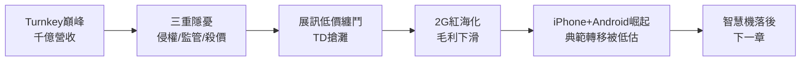

# 3.3 山寨浪潮與展訊攻防（2008-2010）

## 山寨之王的巔峰與陰影

2008 年前後，「山寨機」一詞紅遍兩岸：深圳一年出貨上億支功能機，多數內建聯發科晶片。聯發科 2008 年營收突破新台幣千億元，毛利率仍高，蔡明介被稱為「山寨機之父」。但盛名之下有三重隱憂：品牌廠（諾基亞、三星）控告侵權連帶波及方案商；大陸官方加強入網核准，打擊黑手機；更重要的是，展訊以更低價切入 TD-SCDMA 與低端 GSM，蠶食份額。

## 與展訊的纏鬥

展訊（展訊通信，Spreadtrum）是聯發科在 2G 市場最直接的對手，打法幾乎是聯發科的鏡像：更低價、更貼身的政府關係、主攻 TD-SCDMA（大陸 3G 自有標準）。2008-2010 年雙方在華強北殺價，毛利率雙雙下滑。聯發科憑藉更完整的軟體生態與產能優勢守住高端白牌，但展訊在政策扶持機型中搶下灘頭堡。

這場纏鬥的實質意義是預演：雙方都意識到 2G 已是紅海，真正的決戰在 3G 智慧機。誰先拿出穩定、便宜的 3G/智慧機 Turnkey，誰就能複製 2G 故事。聯發科在此時犯下關鍵遲疑——對 3G 標準（WCDMA/TD-SCDMA）投入分散，又低估了 iPhone（2007）與 Android（2008）帶來的典範轉移，以為智慧機只是「高級功能機」。

## 因果鏈

**前因驅動：** Turnkey 的成功把聯發科推上 2G 巔峰，也將其鎖定在功能機思維與舒適的獲利結構中；展訊競爭加速了 2G 利潤侵蝕，迫使轉型卻又分散資源。

**後果引發：** 2009-2010 年 Android 智慧機起飛時，聯發科在應用處理器（AP）、3G 基頻、軟體生態三線落後，高通趁勢以專利＋晶片綁定收割市場。2G 的因（成功）直接種下 2010 年代初的果（落後），構成下一章逆襲敘事的起點。
