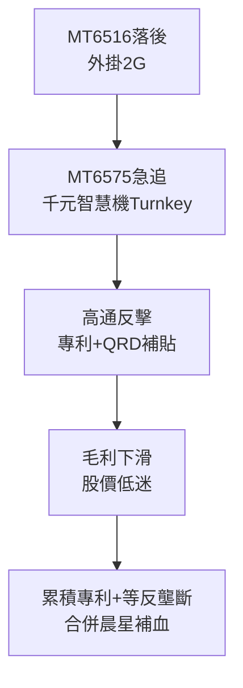

# 4.1 智慧機落後與高通打壓（2010-2013）

## 錯失第一波智慧機

2010-2011 年，HTC、三星、華為紛紛轉向 Android 智慧機，需要 3G＋AP（應用處理器）＋GPU 的高整合方案。高通以 Snapdragon＋專利授權（QTL）綁定，拿下高端；展訊、博通搶低端。聯發科首款智慧機晶片 MT6516（2009-2010） Standalone AP 外掛 2G，體驗落差大，乏人問津，被譏「功能機廠商」。

2011-2012 年聯發科急起直追，推出 MT6573/6575（Cortex-A9＋WCDMA），以 Turnkey 模式複製貼上：公板＋Android 客製＋交鑰匙，迅速打入大陸千元智慧機（聯想、酷派、中興）。但高通隨即發動專利與價格雙重打壓：對不付高通專利費的白牌廠施壓，並推出 QRD（Qualcomm Reference Design）模仿 Turnkey，以補貼搶客戶。聯發科毛利率從 50% 以上滑落至 40% 出頭，股價低迷。

## 專利戰的結構性劣勢

手機專利遊戲規則對後進極不利：高通按整機價格收取約 3-5% 專利費（$Fee = p \times Q \times r$），聯發科客戶多為低價機，議價力弱。聯發科一方面繳費求生，一方面累積自身 3G/4G 專利，並遊說兩岸政府介入反壟斷（後來大陸 2015 年對高通開出近 10 億美元罰單，間接利多聯發科）。

## 因果鏈

**前因驅動：** 2G 舒適圈導致的 AP 與 3G 投入遲到＋Android 典範轉移速度超預期，共同造成落後；高通的專利—晶片綁定模式則放大了落後者的痛苦。

**後果引發：** 落後迫使聯發科走兩條自救路：一是橫向合併（吃下電視晶片龍頭晨星，擴大規模與現金流），二是縱向改革（引入台積電出身的蔡力行整頓戰力），分別在下一兩節展開。
