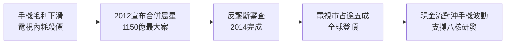

# 4.2 晨星合併與電視晶片登頂（2012-2014）

## 台灣 IC 設計最大合併案

2012 年 6 月，聯發科宣布以約 1,150 億元新台幣（換股＋現金）收購晨星半導體（MStar），創下台灣 IC 設計史上最大合併案。晨星是全球電視控制晶片龍頭，市占率長期第一，與聯發科在手機、DVD 互補，但在電視、機上盒領域是直接對手，雙方曾殺價多年。

合併動機有三：一是消除電視領域的內耗，把毛利打回來；二是合併營收與專利，增強對高通的對等談判力；三是取得晨星在大陸電視客戶（TCL、海信、創維）與技術（影像畫質、MEMC），為日後智慧電視、Wi-Fi 整合鋪路。全案歷經大陸商務部反壟斷審查，附條件於 2014 年 2 月完成合併。

## 整合之痛與登頂

合併後聯發科一舉成為全球電視晶片無可爭議的霸主（市占逾五成），並在機上盒、顯示器晶片同步領先。電視業務提供穩定的現金流，對沖手機業務的劇烈波動，使公司在 2013-2014 年得以支撐八核心 MT6592 等高投入研發。

但整合並不容易：晨星團隊文化強悍，雙總部磨合、人事重疊、產品線重整耗時兩年。蔡明介以「以時間換空間」容忍陣痛，最終留住核心人才。這次合併也被視為聯發科從「手機公司」轉為「平台型 IC 設計公司」的起點。

## 因果鏈

**前因驅動：** 高通打壓造成的手機獨木橋風險＋與晨星多年殺價的雙輸，驅動了合併；手機 Turnkey 時代累積的資本正是支付合併的底氣。

**後果引發：** 晨星合併帶來規模、電視霸權與大陸客戶關係，使聯發科有本錢在 2014-2017 年與高通打一場 4G 消耗戰而不致斷糧；同時電視 SoC 的影像、連網技術，成為日後 Wi-Fi 6、車用座艙的技術種子。
