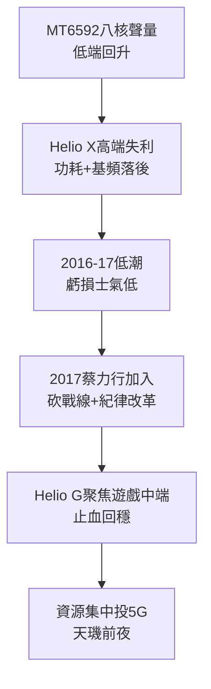

# 4.3 Helio 與 4G 及蔡力行改革（2014-2019）

## 八核噱頭與 Helio 品牌

2013-2014 年聯發科以全球首款真八核 MT6592 搶得聲量，搭載於紅米、小米低端機，以「核戰」對抗高通四核，一時市占回升。2015 年推出高階品牌 Helio（X10/X20 十核心），試圖上攻高端。但 Helio X 系列功耗與基頻（4G Cat.6 落後高通 Cat.9+）不及預期，加上台積電 20nm/16nm 初期良率與調度劣勢，高端突破失敗，2016-2017 年手機業務虧損、士氣低迷。

## 蔡力行改革

2017 年，蔡明介請來台積電前總執行長蔡力行擔任共同執行長，2018 年蔡力行接任執行長（蔡明介留任董事長），啟動組織與產品線整頓：砍掉賠錢的平板、低階功能機尾巴，聚焦「中端放量＋旗艦試探」；導入台積電式的紀律、里程碑管理與客戶分級；將研發資源向 5G、Wi-Fi 6、車用集中，減少機海戰術。2018-2019 年推出的 Helio G90T（主打遊戲）以高性價比扳回一城，證明中端聚焦有效。

> 資源集中公式：设總研發 $R$ ，戰線數 $n$ ，則單線強度 $R/n$ 。蔡力行把 $n$ 砍半，使 5G 單線強度倍增，為天璣突圍積蓄能量。

## 因果鏈

**前因驅動：** 高通 4G 領先＋晨星合併後的組織龐雜，共同造成 Helio 高端冒進的失敗；失敗反過來證明必須改革，促成蔡力行時刻。

**後果引發：** 改革砍掉的不是研發總量而是分散度，把子彈留給 5G。若無 2017-2019 年的止血與聚焦，2019 年天璣 1000 不可能準時以台積電 7nm 交卷，5G 超車窗口將稍縱即逝。
