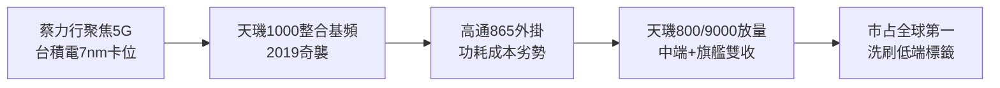

# 5.1 天璣突圍與 5G 超車（2019-2021）

## 天璣 1000 的奇襲

2019 年 11 月，聯發科發表首款 5G SoC 天璣 1000（Dimensity 1000），採用台積電 7nm，整合 5G 基頻（Sub-6GHz），AI 與影像規格越級。2020 年再推天璣 800/820 主攻中端，以性價比橫掃大陸與東南亞 5G 千元機。高通當時旗艦驍龍 865 仍採外掛基頻（X55），功耗與成本居高不下，給了天璣切入窗口。

2020-2021 年 further 推出天璣 9000（台積電 4nm，ARMv9＋Cortex-X2），安兔兔跑分一度超越同代驍龍 8 Gen 1，且功耗口碑反超，首度在旗艦體驗上與高通平起平坐。OPPO、vivo、小米、榮耀大舉採用，聯發科手機 SoC 全球市占率登頂（Counterpoint 口徑逾三成），徹底洗刷「低端」標籤。

## 為何這次超車成功？

三因共振：一是技術路線賭對——堅持整合基頻＋提早卡位台積電先進製程，而高通為照顧自家基頻外掛節奏慢半拍；二是蔡力行改革留下的執行力——里程碑準時、客戶分級清晰；三是地緣與市場結構——華為海思被制裁空出的大陸份額，以及 5G 換機潮的量（$Q_{5G}$ 爆發使 $mQ > F$ 輕鬆成立）。

## 因果鏈

**前因驅動：** 前章改革積蓄的執行力＋晨星時代練就的多產品協同＋台積電製程奧援，共同把 5G 窗口轉化為超車；華為缺席則是天賜的外生需求衝擊。

**後果引發：** 天璣突圍帶來空前現金與品牌溢價，使聯發科首度有餘裕同時投入 Wi-Fi、電視、車用、ASIC 多線作戰，並在 2020 年登上台灣 IC 設計市值王——5G 一戰的果，成為多元佈局的因。
