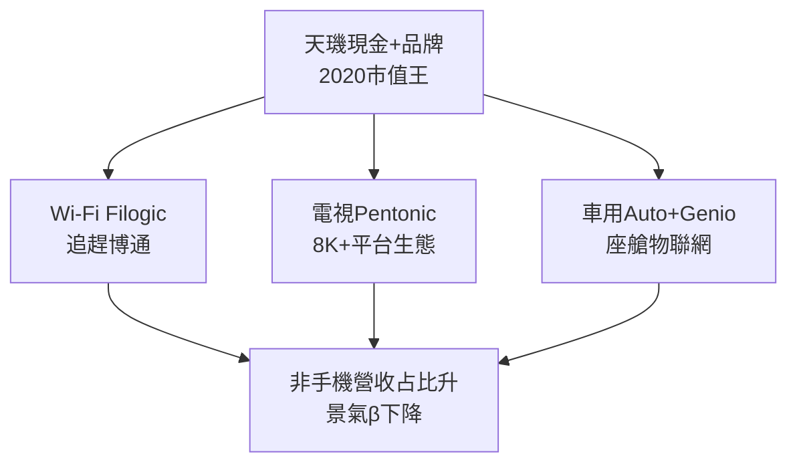

# 5.2 市值王與 Wi-Fi 電視車用版圖（2020-2023）

## 台灣 IC 設計市值王

2020 年，聯發科股價、市值超越大立光等，登頂台灣 IC 設計市值王（僅次於台積電的半導體權值股），並入選全球前十大半導體廠之列。5G 放量＋疫情遠距商機（電視、Wi-Fi、平板、Chromebook）推升營收連創新高，2021 年營收突破新台幣 5,000 億元，毛利率重返五成。

## 多元版圖：不只手機

- **Wi-Fi：** 承接晨星連網與自身藍牙/GPS 能力，Filogic 系列在 Wi-Fi 6/6E/7 拿下寬頻路由器、PC 品牌大單，市占緊追博通。
- **電視與智慧家庭：** 電視 SoC 全球過半，Pentonic 系列支援 8K 與 AI 畫質，並打入亞馬遜 Fire TV、Google TV 平台。
- **車用與物聯網：** Dimensity Auto 座艙平台切入中國電動車廠，Genio 物聯網平台佈局工業與智慧零售。
- **電源與連接：** 快充、藍牙音訊、GNSS 形成長尾現金流，對沖手機週期。

此階段戰略可概括為「手機旗艦立品牌、非手機放量穩獲利」，降低對單一市場的 $\beta$（景氣敏感度）。

## 因果鏈

**前因驅動：** 天璣突圍的現金與議價力＋晨星電視/連網的技術種子＋疫情遠距需求，三者疊加使多元佈局從口號變為財報現實。

**後果引發：** 多元版圖提供了穿越手機下行週期（2022-2023 去庫存）的緩衝，也練就了服務車廠、網通廠等非手機客戶的系統能力——這正是切入雲端 ASIC（服務 hyperscaler 大客戶）所需的前置能力，引出下一節。
