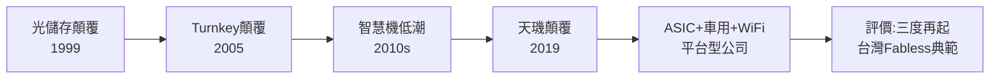

# 5.3 ASIC 新局與歷史評價（2023-2026）

## 切入 AI ASIC 與運算

2023 年起生成式 AI 引爆雲端算力需求，博通、Marvell 以 ASIC（客製化 AI 加速器）服務 Google、Meta、亞馬遜。聯發科憑藉台積電先進製程合作經驗、SerDes/高速介面 IP（來自晨星＋自研）與低功耗 SoC 能力，切入雲端 AI ASIC 與邊緣 AI（手機端生成式 AI，如天璣 9300 支援端側大模型）雙線。2024-2025 年傳出與輝達（NVIDIA）、Google 合作車用、AI 相關專案，儘管細節未全公開，但方向明確：從「手機 SoC 廠」升級為「運算＋連接平台廠」。

## 歷史評價：三種顛覆

回顧聯發科近三十年，可歸納為三次典範級顛覆，皆循同一公式——**落後市場＋高整合＋交鑰匙服務**：

1. **光儲存（1999-2001）：** 以單晶片打敗日歐大廠，證明台灣 Fabless 可以定義全球標準品。
2. **功能機 Turnkey（2005-2008）：** 以交鑰匙把手機從高科技變為快消品，改寫大陸產業分工。
3. **5G 天璣（2019-2021）：** 以整合基頻＋製程卡位，在高端與高通分庭抗禮，擺脫低端宿命。

其代價亦清晰：兩次轉型遲疑（3G、4G 初期）皆因沉溺於前一波成功。但相較於多數一波流的 IC 設計公司，聯發科能三度再起，關鍵在蔡明介—蔡力行兩代領導的互補：前者以節儉與市場嗅覺開疆，後者以紀律與聚焦守成開創新局。

> 若以長期股東回報 $R = \prod_t (1+g_t) - 1$ 衡量，聯發科的 $g_t$ 雖波動劇烈，但三波 $g$ 高峰足以覆蓋低谷，呈現典型「階躍式成長」而非線性成長。

## 因果鏈

**前因驅動：** 本節是全書因果鏈的收束——沒有柏克萊的系統觀，就沒有 SoC 整合基因；沒有光儲存現金，就沒有手機賭注；沒有 Turnkey 教訓，就沒有 Helio 反思；沒有蔡力行改革與晨星規模，就沒有天璣超車；沒有天璣現金與多元客戶能力，就沒有 ASIC 新局。每一環既是前果又是後因。

**後果引發：** 聯發科的下一步（AI ASIC、6G、車用）仍是同一命題的延續：能否在新的「落後但夠大」的市場複製整合＋服務公式。歷史給出的答案是審慎樂觀——這家公司最擅長的，正是在不被看好處開出新局。
