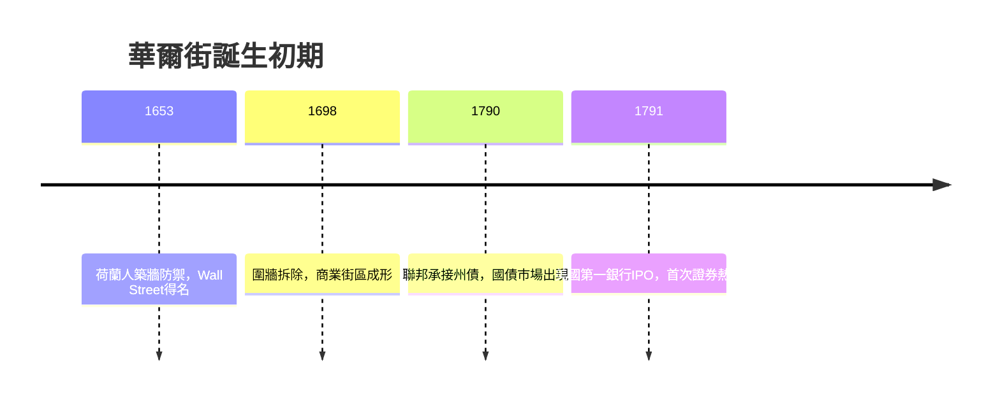

# 1.1 圍牆、碼頭與街區的誕生

十七世紀的荷蘭殖民者在曼哈頓南端建立了新阿姆斯特丹，1653年為防禦英國人與原住民，沿著街道北緣築起一道木圍牆，「華爾街」（Wall Street）之名由此而來。圍牆從來沒有真正擋住敵人，卻意外擋出了歷史：牆邊的東河碼頭是美洲與歐洲貿易的咽喉，麵粉、皮毛、蔗糖在此集散，商人需要信用、匯票與風險分擔，金融需求於是自然聚集在這條短短的街道上。

1664年英國人奪取新阿姆斯特丹，圍牆於1698年拆除，但街區的商業基因延續下來。紐約的優勢在於地理：港灣深、冬天不凍，且哈德遜河通往內陸。當聯邦政府在1790年代接手各州戰爭債務、發行第一批國債，並在1791年成立美國第一銀行（Bank of the United States）時，華爾街出現了第一次證券熱潮——「第一銀行股票IPO」引發了美國史上第一次投機泡沫（1792年恐慌的前奏），也讓「證券交易」從附屬於貿易的行為，變成一種獨立的生意。

**因果分析**：這段歷史的驅動邏輯是「貿易需要金融，金融改造貿易」。防禦工事創造了街道，碼頭貿易創造了信用需求，而聯邦國債創造了第一批可交易證券。三者疊加，使華爾街從地理名詞轉化為功能概念——當證券持有人開始在特定地點聚集議價，資本市場的雛形便已埋下，直接催生了下一節的梧桐樹協定。
