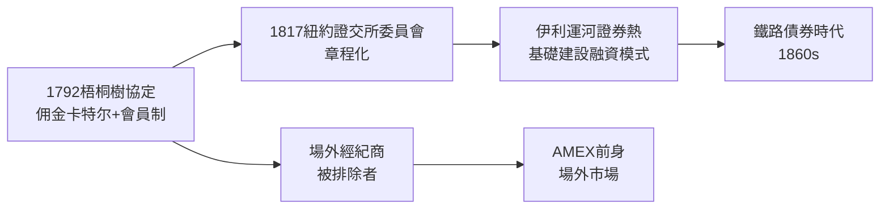

# 1.2 梧桐樹協定與交易所的雛形

1792年3月，經歷了第一銀行股票的投機狂潮與隨之而來的崩跌後，紐約的二十四位經紀人在華爾街68號前的一棵梧桐樹下簽署了後世稱為《梧桐樹協定》（Buttonwood Agreement）的文件。協定只有兩條核心精神：會員之間互相交易證券，並且收取固定（不低於千分之二十五）的佣金——排他與壟斷，從華爾街誕生的第一天起就寫進了 DNA。

1817年，這個俱樂部正式改名為「紐約證券交易委員會」（New York Stock & Exchange Board），訂出章程、座位表與交易時間。此時的市場以政府債券與銀行股票為主，規模有限。真正的轉折是伊利運河（Erie Canal, 1817-1825）：運河公司發行的債券與股票在華爾街大賣，證明基礎建設證券可以被歐洲資本市場消化，於是「華爾街承銷、內陸工程、歐洲出錢」的模式成型，州債、運河債與鐵路債成為19世紀上半葉的主要商品。1842年成立的紐約商業交易所（後來的AMEX前身之一）則代表被梧桐樹俱樂部排拒的場外交易者另立門戶。

**因果分析**：梧桐樹協定是一次「市場失靈後的自組織」——投機崩盤使經紀人相互踩踏削價，於是用卡特尔化止損。這解釋了華爾街此後一百五十年的核心張力：交易所是私人俱樂部（追求壟斷利益），卻承載公共功能（價格發現與融資）。這個張力一直延續到1934年SEC強制自律管理，甚至到今日的自我監管組織（SRO）架構。
