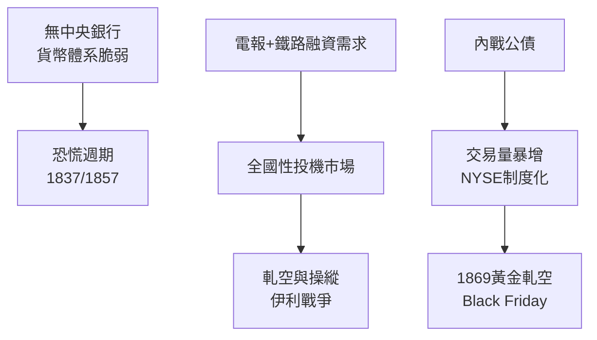

# 1.3 恐慌、賣空與內戰時代的投機

十九世紀的華爾街沒有中央銀行作為最後貸款人（第二合眾國銀行1836年因傑克森總統否決而倒閉），貨幣體系靠金銀與州特許銀行鈔票支撐，因此恐慌週期性地爆發：1837年恐慌由土地投機與英國資本撤回觸發，1857年恐慌由鐵路與俄亥俄人壽倒閉引發。恐慌的標準劇本——投機熱、槓桿堆高、外資撤退、銀行擠兌、信用凍結——此後不斷重演，成為理解華爾街每一次危機的原型。

1857年後，鐵路取代運河與州債成為市場主角。鐵路是當時最資本密集的產業，需要持續發行股票與債券，這使華爾街第一次擁有「持續性的大規模融資需求」。同時，電報（1844年商用）讓紐約與費城、波士頓的價格即時連動，投機從區域性變成全國性。丹尼爾·德魯、科尼利爾斯·范德比爾特與傑伊·古爾德等人在此登場：操縱、軋空（corner）、掺水股（watered stock）成為常態，伊利戰爭（1866-1868）中范德比爾特與古爾德爭奪伊利鐵路控制權，甚至賄賂議員立法，把華爾街的野蠻推向頂點。

內戰期間（1861-1865），聯邦發行巨額戰爭公債，交易量暴增，紐約證交所正式改名為 New York Stock Exchange，並於1865年遷入現址。戰爭同時催生了「綠鈔」（greenbacks）紙幣與黃金投機——1864年古爾德的黃金軋空（Black Friday, 1869）正是其延伸。

**因果分析**：這一節的關鍵因果是「制度真空 → 私人秩序與混亂並存」。缺乏監管與央行，恐慌無人收拾；缺乏資訊披露，操縱成為合理策略；但恰恰是鐵路與戰爭債券帶來的龐大融資需求，逼出了更專業的證交所與承銷體系。混亂與規模同步成長，為下一章J.P.摩根用私人力量「秩序化」華爾街提供了舞台。
