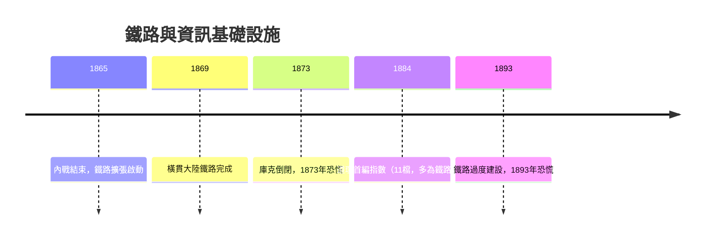

# 2.1 鐵路融資與華爾街的工業化

內戰結束後，美國迎來史上最狂暴的鐵路擴張：鐵路里程從1865年的約3.5萬英里暴增至1900年的近26萬英里。這種擴張不可能靠利潤自籌，只能靠資本市場——發行債券支付建設成本，發行股票籌集股本，再以未來運費收入償付。華爾街由此從「政府債券與少數銀行股」的市場，蛻變為「工業資本主義的融資引擎」。

鐵路也重塑了華爾街的商業模式。鐵路證券數量龐大、種類繁多，散戶無法自行評估，於是「承銷商」與「資訊中介」的價值浮現。傑伊·庫克在南北戰爭中首創全國零售網銷售公債，戰後將同樣手法用於北太平洋鐵路；1873年他因鐵路滯銷而倒閉，引發1873年恐慌與長達六年的蕭條——這是「承銷商倒閉→信用凍結」因果鏈的早期範本。同時，鐵路使美國成為統一的全国市場：小麥、鋼鐵、石油的價格由全國供需決定，標準普爾的前身（Henry Varnum Poor的鐵路統計，1860年代）與道瓊指數（1884年首編、以鐵路股為主）正是為滿足資訊需求而生。

**因果分析**：因果鏈是「基礎設施資本密集 → 必須資本市場融資 → 市場規模與風險同步放大」。鐵路供給（運力）領先需求（運量），週期性過度建設必然引發1893年式的恐慌；而每一次恐慌都淘汰弱者、集中股權，為摩根式重組（下一節）創造了商機。華爾街與鐵路互相驅動：沒有鐵路就沒有現代投資銀行，沒有投資銀行也沒有鐵路。
