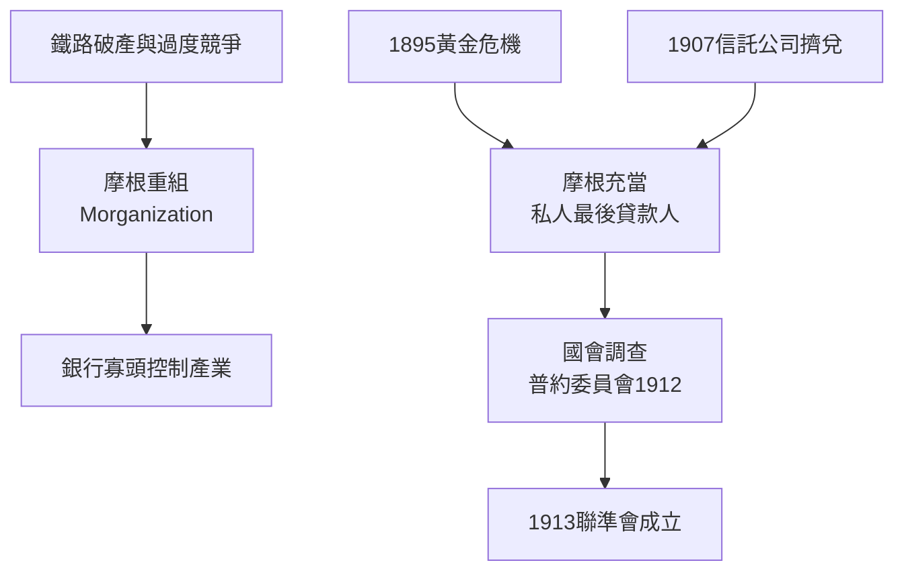

# 2.2 J.P.摩根與金融寡頭秩序

皮爾龐特·摩根（J.P. Morgan）不是靠投機致富，而是靠「秩序」致富。他繼承父業（倫敦皮博迪公司的紐約代理），掌握歐洲資本流向美國的閘門。摩根的方法論是「Morganization」：當鐵路因過度競爭與債務而破產，他買下債權、重組公司、取得董事會席位，並迫使競爭路線達成運價協議——用股權與董事席次織成一張私人控制網。到1900年代，紐約中央、賓州、伊利等主要鐵路的命運都與華爾街銀行綁定。

1895年，摩根在黃金危機中組織銀行團向克利夫蘭總統政府出售350萬盎司黃金，穩住金本位——沒有央行的年代，摩根就是最後貸款人。1901年他將卡內基鋼鐵併入美國鋼鐵公司（US Steel，資本額14億美元，約當當年GDP的7%），證明華爾街可以「製造」巨型企业。1907年恐慌則是摩根秩序的極致與黃昏：信託公司擠兌引發連鎖危機，年屆七十的摩根召集銀行家在自己書房徹夜鎖門逼其出資，憑一己之力止血。

**因果分析**：摩根現象的因果是「制度真空 → 私人權力填補」。沒有央行，摩根必須親自救市；沒有證券法，銀行必須以董事席位自我保護。但私人秩序累積的權力太大，1907年後連政治界都無法容忍——普約委員會（1912-1913）聽證揭露貨幣信託（Money Trust）的壟斷，直接催生1913年聯準會與後續證券立法。華爾街第一次證明：危機由私人解決，也由危機本身招來公共監管。
