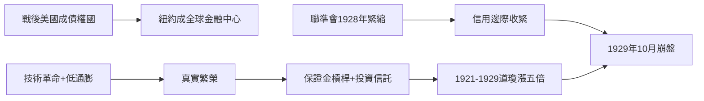

# 2.3 1920年代牛市與崩盤前夕

一次大戰徹底改變了華爾街的世界地位。戰前美國是債務國，歐洲資本經由摩根們流入；戰後歐洲滿目瘡痍，紐約取代倫敦成為全球債權中心。聯準會成立（1913）提供了初步的貨幣彈性，戰爭公債的全國推銷更讓數千萬美國人第一次成為證券持有人——「人人都該擁有股票」的觀念由此扎根。

1920年代的牛市有真實基礎：電力、汽車、收音機、化工引領的技術革命，加上柯立芝繁榮的低通膨與高生產率。但泡沫機制很快蓋過基本面。經紀商貸款（broker loans）讓投資人可以一成保證金、九成借貸買股；1928-1929年經紀商貸款總額超過80億美元，股市市值以每年數百億的速度膨脹。投資信託（investment trusts）層層槓桿化，像1929年高盛交易公司（Goldman Sachs Trading Corporation）那樣用子公司持倉母公司股票，形成金字塔式的自我循環。道瓊指數從1921年的75點漲到1929年9月的381點，八年五倍。

聯準會並非沒有警覺：1928年起多次提高重貼現率試圖抑制華爾街投機，但緊縮同時傷及實體經濟，且無法阻止透過企業盈餘與外資流入的槓桿。經濟學家費雪（Irving Fisher）在崩盤前宣稱股價已站上「永久高原」——這句話成為泡沫心理學的永恆標本。

**因果分析**：1929年前夕的因果結構是「真實繁榮提供敘事，槓桿提供燃料」。技術進步是真的，於是漲幅有了合理性外衣；保證金與金字塔信託把漲幅變成自我實現的螺旋。聯準會的兩難——打擊投機會掐死經濟、放任投機會吹大泡沫——是所有中央銀行的永恆難題，並在2008年再次上演。崩盤本身將在下一章展開。
