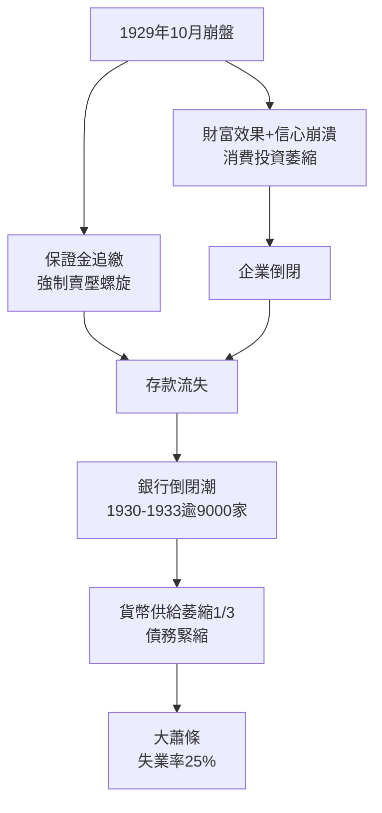

# 3.1 1929大崩盤與大蕭條

1929年10月24日（黑色星期四）恐慌性賣出湧入，交易所場面失控，銀行家團上午緊急集資護盤暫時穩住行情；但10月28日與29日（黑色星期一、二）賣壓再起，兩日道瓊重挫逾23%。此後市場未能復原：到1932年7月，道瓊從381點跌至41點，市值蒸發近九成。若說崩盤是金融事件，大蕭條則是金融向實體的傳染：數千家銀行倒閉（1930-1933年間逾九千家），貨幣供給萎縮三分之一，失業率在1933年達到25%。

崩盤如何變成大蕭條，經濟學史上的兩大解釋至今並存。弗里德曼與施瓦茨歸因於聯準會的貨幣緊縮失職——銀行倒閉時袖手旁觀，任由貨幣乘數反向運轉；柏南克則強調金融中介癱瘓：信貸管道斷裂，即使名目利率接近零，實際借貸成本仍高不可攀，形成債務緊縮（Fisher, 1933）。保證金槓桿加速了下跌：股價一跌，經紀商追繳保證金，投資人被迫賣股還款，賣壓再壓低股價，螺旋自我強化。

**因果分析**：大蕭條的核心因果是「金融脆弱性 × 政策不作為」。崩盤本身（跌幅）未必致命，致命的是三個放大器：槓桿（保證金）、中介癱瘓（銀行倒閉）、政策被動（金本位束縛下聯準會不救）。這個教訓成為2008年危機處理的教科書——柏南克正是研究大蕭條的學者，其量化寬鬆即為「絕不重蹈1930年代覆轍」的直接產物。崩盤的政治後果（SEC與證券立法）見下一節。
