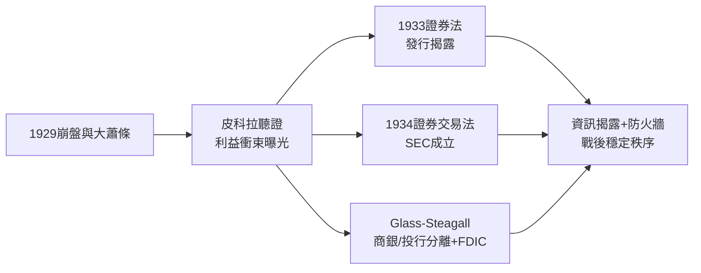

# 3.2 SEC成立與玻璃-斯蒂格爾法案

大蕭條點燃的政治怒火直接指向華爾街。參議院貨幣委員會舉行的皮科拉聽證（Pecora Hearings, 1932-1934）揭露了觸目驚心的細節：國民城市銀行（今花旗前身）的公債承銷以虧損塞給自己信託帳戶、合夥人免繳所得稅、做莊手法操縱自家股票。聽證把「利益衝突」從抽象概念變成報紙頭條，立法動能因此勢不可擋。

立法分兩層。1933年《證券法》管發行端：新證券必須註冊、揭露財務資訊，承銷商對虛假揭露負民事責任——「賣給投資人前，先讓他看得見」。1934年《證券交易法》管交易端：成立證券交易委員會（SEC），強制上市公司定期揭露、禁止操縱、規範經紀商，並把證交所納入自律監管。同時《格拉斯-斯蒂格爾法案》（Glass-Steagall, 1933）切斷商業銀行與投資銀行：存款業務不得承銷證券，JP摩根被迫分拆出摩根士丹利；另設存款保險（FDIC）與聯準會的監管 Q條例。第一任SEC主席由約瑟夫·甘迺迪出任，顯示新政的務實——用懂市場的人管市場。

**因果分析**：這一節的因果是「災難 → 聽證 → 立法 → 制度」。SEC體制的哲學不是禁止投機，而是強制資訊對稱，讓市場自己定價——這承認了1920年代「謠言與操縱市」的病根。Glass-Steagall則針對利益衝突：銀行不能一邊吸收存款、一邊承銷賣給存款人。這道防火牆維持了六十餘年，直到1999年廢止，並在2008年危機後被廣泛檢討——制度壽命本身就是因果的證明。
