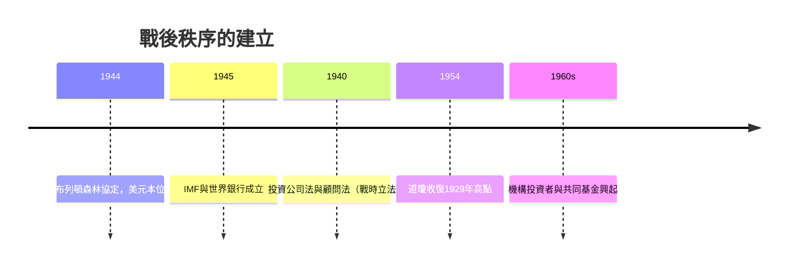

# 3.3 布列頓森林與戰後資本主義

兩次大戰之間的國際貨幣混亂——金本位崩潰、競爭性貶值、貿易壁壘——被普遍視為大蕭條加深與二次大戰爆發的幫兇。因此1944年7月，44國代表齊聚新罕布夏州的布列頓森林（Bretton Woods），在凱恩斯與美國代表懷特的設計下重建國際貨幣秩序：各國貨幣釘住美元，美元以35美元兌一盎司黃金與黃金掛鉤（金匯兌本位），並成立國際貨幣基金（IMF）處理短期收支失衡、世界銀行支援重建。

布列頓森林體系刻意「關閉」了資本帳：各國保留外匯管制，資本跨境流動受限。這對華爾街意味著國際業務萎縮，但在國內，戰後環境堪稱黃金時代——1934年至1960年代，美股年化實質報酬約9%，波動遠低於1920年代；機構投資者（退休金、共同基金）在1950-60年代興起，成為市場的新主人。立法面，《投資公司法》（1940）規範了基金業，《投資顧問法》規範了理財業，SEC體制補齊最後拼圖。1954年道瓊終於收復1929年高點，用掉25年。

**因果分析**：布列頓森林與華爾街的因果關係是「國內穩定換國際封閉」。固定匯率與資本管制壓縮了金融工程的空間，卻創造了史上最長的股票溫和牛市——低波動、低槓桿、高成長。這個秩序內建矛盾：全球需要美元流動性（特里芬難題），美國卻因越戰與福利支出輸出黃金；當1950年代末美國黃金儲備開始流失，體系崩潰的種子已埋下，將在第4章引爆紙上黃金與浮動匯率的革命。
