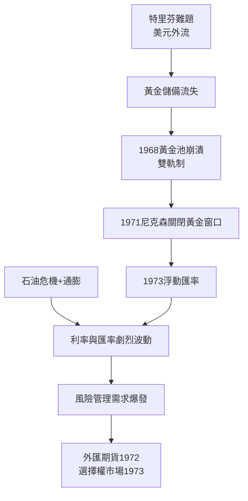

# 4.1 布列頓森林崩潰、通膨與紙上黃金

布列頓森林體系的內在矛盾（特里芬難題）在1960年代全面爆發：美國以越戰與大社會計畫輸出美元，外國持有的美元債權遠超美國黃金儲備。1961年起各國央行組成倫敦黃金池（Gold Pool）以35美元官價拋金護市，但私人需求持續超過供給。1968年黃金池崩潰，改行雙軌制（官價35美元、市價自由浮動）——「紙上黃金」與「實體黃金」自此分道。1971年8月15日，尼克森宣布關閉黃金窗口（Nixon Shock），美元與黃金脫鉤；1973年主要貨幣全面浮動，布列頓森林正式終結。

匯率自由浮動、石油危機（1973、1979）推升通膨、利率劇烈波動——風險的種類與規模同時放大，而市場上幾乎沒有對沖工具。這正是衍生品革命的動機：既然價格必然波動，就需要轉移波動的市場。1971年哥倫比亞大學退休基金案例顯示機構開始轉向量化配置；1972年IMM推出外匯期貨，1973年CBOE開出股票選擇權市場。華爾街從「為儲蓄與建設融資」轉向「為風險定價與轉移」的全新定位。

**因果分析**：這一節的因果是「宏觀秩序崩潰 → 微觀金融革命」。固定匯率時代，企業與投資人面對的價格風險有限；匯率、利率、通膨同時解錨後，避險從奢侈品變成必需品，衍生品市場的需求由政策劇變直接催生。同時，高通膨使固定收益資產崩跌，迫使機構資金轉向股票與另類策略——為下一節的量化革命提供了資金與動機。
