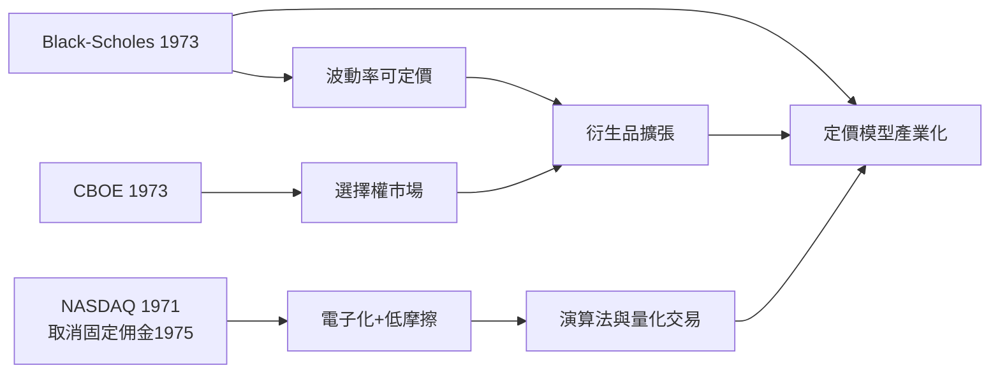

# 4.2 電子交易、衍生品與Black-Scholes革命

1973年，費雪·布萊克與邁倫·休斯（Myron Scholes）發表選擇權定價公式，羅伯特·默頓（Robert Merton）補上數學基礎，三人（布萊克於1995年去世，休斯與默頓獲1997年諾貝爾獎）把「波動率」變成可交易的變數。Black-Scholes公式的核心是無套利與delta避險：

$$C = S_0 N(d_1) - K e^{-rT} N(d_2), \quad d_1 = \frac{\ln(S_0/K) + (r + \sigma^2/2)T}{\sigma\sqrt{T}}$$

公式的偉大在於可計算：德州儀器的計算機幾乎同步問世，交易員在CBOE開市首日就用它報價，選擇權成交量爆發。定價模型、交易所、計算硬體三者同時到位，這是金融史上罕見的「技術—理論—制度」共振。

同時，交易所的電子化開始起步：1971年NASDAQ以報價螢幕網路成立，不需實體場地；1975年NYSE取消固定佣金（梧桐樹協定兩百年後的終結），佣金戰使機構演算法交易有了經濟動機。資本資產定價模型（CAPM）與有效市場假說在學院普及：

$$E(R_i) = R_f + \beta_i \left( E(R_m) - R_f \right)$$

β、市場組合、指數化（1976年Vanguard第一檔零售指數基金）把投資從「選股藝術」轉為「因子工程」。1982年股指期貨上市，1983年股指選擇權，衍生品與現貨的套利網路成型。

**因果分析**：因果鏈是「理論 → 工具 → 市場結構變革」。Black-Scholes讓風險有價格，交易所讓風險可交易，電子化讓交易成本下降，三者疊加把華爾街從人際撮合的俱樂部變成計算撮合的機器。CAPM與指數化則從需求端改造資金流向：既然大多數主動經理跑不贏市場，資金就會流向低成本被動工具——這條線將在2000年代後主宰市場（見5.3）。
