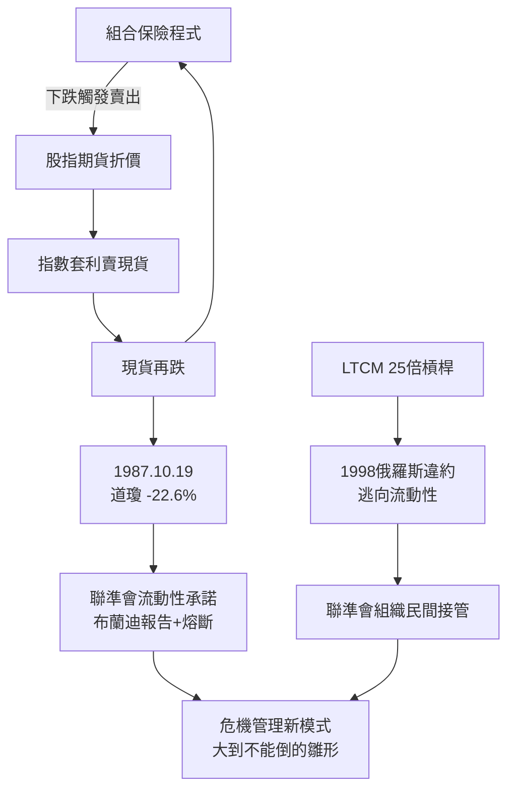

# 4.3 1987黑色星期一與LTCM的教訓

1980年代的華爾街由兩股力量驅動：併購槓桿（垃圾債、敵意收購，Milken與Drexel的時代）與投資組合保險（portfolio insurance）——用股指期貨動態避險模擬賣出選擇權。1987年10月19日（黑色星期一），道瓊單日暴跌22.6%，創史上最大單日跌幅。崩盤的機制極具現代性：下跌觸發組合保險程式賣出期貨 → 期貨相對現貨折價 → 指數套利者賣出現貨 → 現貨再跌 → 程式再賣。沒有大蕭條式的經濟惡化，純粹是流動性與機械化賣壓的死亡螺旋，且全球市場同日連動。

聯準會的反應成為新典範：格林斯潘次日清晨宣布「準備提供流動性支持經濟與金融體系」，各大銀行對證券行放款暢通——最後貸款人功能首次明確覆蓋證券市場，市場數日內企穩。事後的布蘭迪報告催生了熔斷機制（circuit breakers）。十年後的1998年，長期資本管理公司（LTCM）提供另一堂課：兩位諾貝爾獎得主坐鎮、槓桿超過25倍、以流動性極差的衍生品倉位押注收斂交易，俄羅斯違約引發全球逃向流動性，LTCM數週內瀕臨破產，聯準會召集14家銀行出資36.25億美元接管。2008年危機中雷曼未被拯救，正是這個先例陰影下的政策分岔。

**因果分析**：1987與1998的共同因果是「模型同質化 → 交易擁擠 → 流動性瞬間蒸發」。當所有人用同一套模型、同一種避險，避險本身變成風險來源。兩次事件的差異在政府角色：1987靠流動性承諾止血，1998已需要組織紓困，「道德風險」與「系統重要性」的兩難從此成為監管核心議題，並在2008年推向極致。
