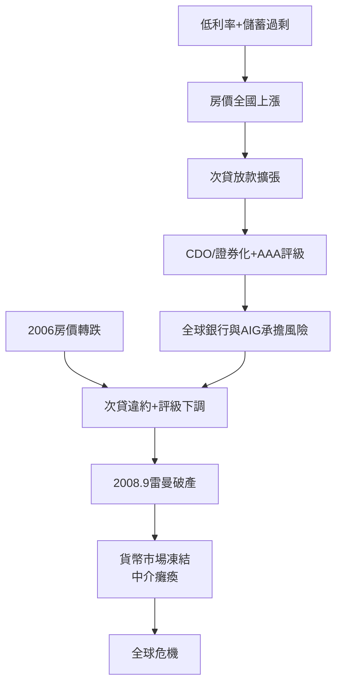

# 5.1 次貸與2008金融海嘯

2008年金融海嘯的火種在2000年代點燃：科技泡沫後聯準會長期維持1%低利率，全球儲蓄過剩壓低長端利率，房價全國性上漲。金融工程的鏈條是：銀行放款給次級信貸借款人 → 打包成擔保債務憑證（CDO）→ 評等機構給予AAA → 出售給全球投資人；同時信用違約交換（CDS）提供「保險」，AIG賣出數千億美元的CDS保護而未提足額準備。結構化讓風險看似分散，實則把全美房價風險濃縮進全球銀行的資本裡。當2006-2007年房價轉跌，最底層的次貸違約透過評級下調與保證金追繳逐層引爆。

2008年的關鍵事件鏈：3月貝爾斯登被賤價出售（聯準會首次救助券商）、9月7日房利美與房地美被政府接管、9月15日雷曼兄弟破產（史上最大破產案）、同日美林賣給美國銀行、9月16日AIG獲850億美元救助。雷曼倒閉凍結了商業票據與貨幣市場基金，貨幣基金「跌破面值」引發贖回潮，連正常企業的短期融資都斷炊——這正是柏南克研究大蕭條時描述的中介癱瘓重演。道瓊從2007年10月14164點跌至2009年3月6470點，全球損失數十兆美元。

**因果分析**：2008年與1929年的因果同構度驚人：都是「真實資產（鐵路/房產）過度投資 → 證券化/槓桿放大 → 資產轉跌 → 中介癱瘓」。差異在政策：2008年聯準會與財政部記住大蕭條教訓，選擇救助（除雷曼外），避免了蕭條但製造了「大到不能倒」的道德風險爭議，直接推動了下一節的監管重構。而危機中銀行靠聯準會零利率生存，也為之後十年的資產價格通膨埋下伏筆。
