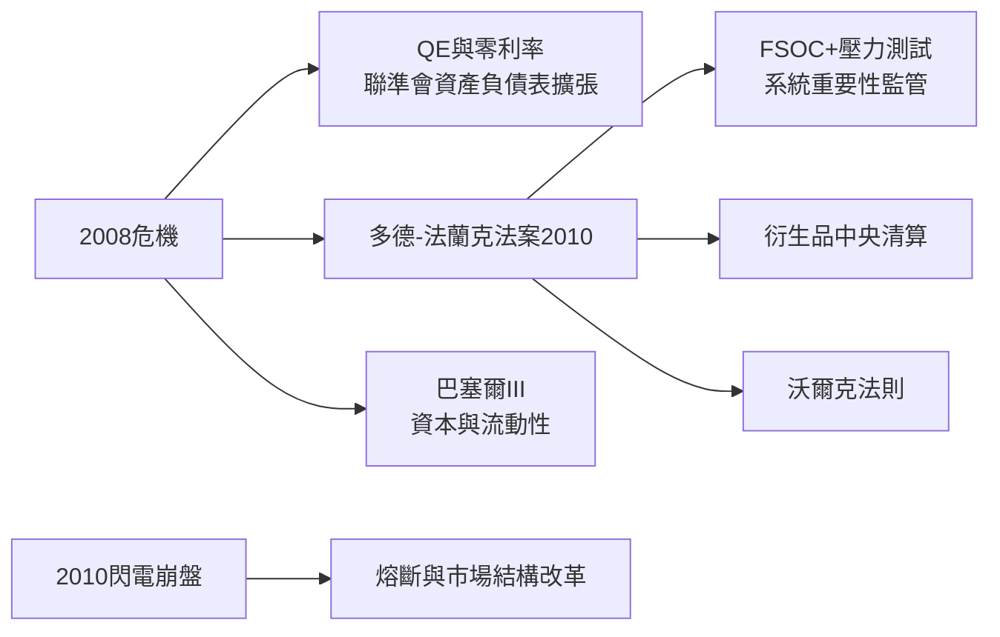

# 5.2 多德-法蘭克法案與量化寬鬆

危機後的兩大政策支柱：貨幣端的量化寬鬆（QE）與監管端的多德-法蘭克法案。聯準會將利率降至零區間，並透過三輪QE大規模購買國債與MBS，資產負債表從2008年的約0.9兆美元膨脹至2017年的4.5兆美元。政策邏輯直接來自對大蕭條的研究：名目利率觸零後，用資產負債表與前瞻指引壓低長期利率。2010年的《多德-法蘭克法案》（Dodd-Frank Act）則是1933-34年以來最大規模的金融立法：成立金融穩定監督委員會（FSOC）辨識系統重要性機構、對大型銀行實施壓力測試與生前遺囑（living wills）、設立消費者金融保護局（CFPB）、要求衍生品進入中央清算與交易報告、加入沃爾克法則（Volcker Rule）禁止銀行自營交易。

同時，2010年5月6日的「閃電崩盤」（Flash Crash）——道瓊數分鐘內暴跌近1000點後迅速收復——暴露了高頻交易與碎片化市場的脆弱，催生單一股票熔斷與市場結構審查。2012年倫敦鯨事件（摩根大通自營損失62億美元）則考驗沃爾克法則的落實。全球層面，巴塞爾協定III大幅提高資本與流動性要求，美國大型銀行的普通股權益比率從危機前的約5%提升至2010年代末的12%以上。

**因果分析**：這一節的因果是「危機深度決定監管強度」。QE救了經濟，卻造成副作用：資產價格上漲、貧富差距擴大、傳統銀行的做市與放款利潤被壓縮——資金被迫流向影子銀行與私募市場。監管則產生規模歧視：合規成本使小銀行與小型券商加速退出，行業集中度上升。緊縮的銀行與寬鬆的貨幣並存，正是下一節「新常態」的結構性原因。
