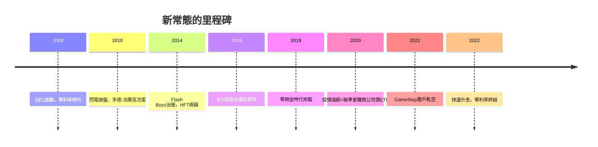

# 5.3 高頻交易、被動投資與當今華爾街

2010年代的華爾街呈現兩大結構性趨勢。其一是交易的機器化：高頻交易（HFT）以微秒級速度與做市策略佔據美股成交量的五成上下，2014年Michael Lewis的《快閃大對決》（Flash Boys）引發「市場是否被操縱」的全國辯論；IEX以350微秒的速度減速線挑戰傳統交易所，最終於2016年獲准成為全國交易所。做市利潤趨零，經紀佣金歸零（2019年羅賓漢引領零佣金時代），散戶訂單流付款（PFOF）成為新的商業模式，2021年的GameStop事件（散戶透過選擇權軋空對沖基金）與其後的監管審查，顯示零售力量與市場結構的張力仍在演化。

其二是資產管理的被動化：低成本指數基金與ETF持續吸金，2020年代被動持股佔美股基金資產已超越主動。三大家（BlackRock、Vanguard、State Street）成為多數大企業的最大股東集合體，公司治理權力空前集中，「指數資本主義」成為學界新課題。同時，2008年後私募股權、創投與私人信貸在監管夾縫中爆發成長，金融活動持續從銀行移向影子體系。2020年疫情引發史上最快崩盤（熔斷四次）與最快復甦——聯準會在數日內重啟QE並首次直接購買公司債ETF，救助工具完全常態化；2022年高通膨則迫使聯準會快速升息，終結零利率時代。

**因果分析**：回望兩百三十餘年，華爾街的驅動引擎始終是同一組因果迴圈：融資需求創造市場，市場聚集財富與權力，權力過度膨脹引發危機，危機催生監管，監管重塑市場並為下一輪創新騰出空間。從梧桐樹下的佣金卡特尔到微秒競速的電子撮合，技術形態劇變，但「槓桿、流動性、資訊不對稱」三個風險源從未消失——差別只在它們藏身於鐵路債券、投資信託、CDO或私人信貸基金之中。理解這個迴圈，就是理解華爾街作為資本主義心臟的歷史。
