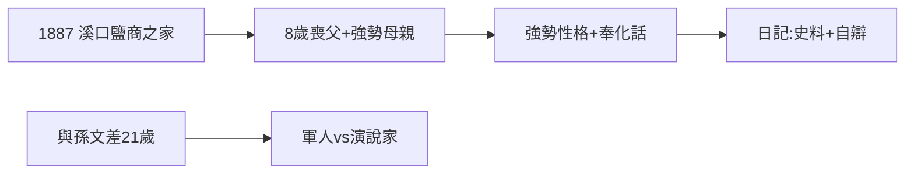

# 1.1 出生（1887）

1887 年 10 月 31 日，蔣介石（名中正，字介石）出生於浙江奉化溪口，家境小康（鹽商）。父親早逝（他 8 歲時），母親王采玉撫養成人——強勢的母親，造就強勢的兒子。

## 溪口的烙印

- 奉化方言終身不改，開會說奉化官話，翻譯轉述——語言的隔閡，後來變成統治的隔閡（在台灣亦然）；
- 母親篤信佛教，蔣早年拜佛，後改信基督教（宋美齡家族的條件，見 3.3）——信仰服務於政治；
- 日記：從 1915 年起幾乎天天寫，現存 Hoover 檔案，是研究他的第一手史料（也是自我辯護的文本，需批判使用）。

## 與孫文的對照

孫文（1866–）是醫生、演說家、世界主義者；蔣（1887–）是軍人、組織者、民族主義者。相差 21 歲的兩代人，性格互補也互斥——孫死後（1925），互補消失，只剩權力。

**因果**：溪口的鹽商之子，帶著方言與日記走天下。母親的強勢內化為他的統治風格——順我者昌的種子，童年已播下。下一節，日本。
