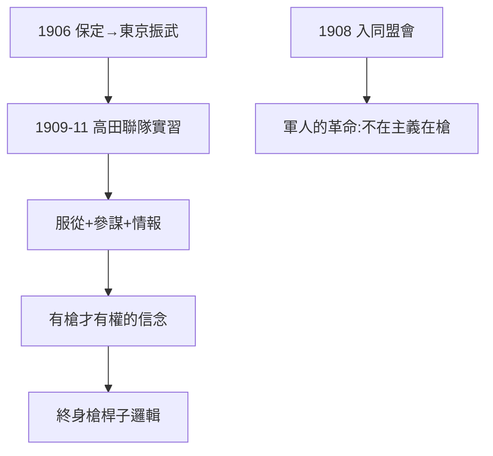

# 1.2 日本士官學校（1906–1911）

## 保定與東京

- 1906 年入保定陸軍速成學堂，旋即赴日，入東京振武學校（陸軍預校）；
- 1909–11 年在日本高田聯隊「野戰實習」（當伍長），接受舊式步兵訓練；
- 日語始終蹩腳（靠翻譯），但日本軍事教育的三樣東西學到手：**服從、參謀作業、情報觀念**。

## 留日生的政治啟蒙

在東京加入同盟會（1908，經陳其美介紹），接觸孫文思想。但他的革命是軍人的革命：不在於三民主義的精微，在於「有槍才有權」——這個信念終身不變（黃埔、北伐、剿共、退台，槍桿子邏輯一貫）。

## 學歷的真相

官方簡歷常寫「日本士官學校畢業」，實際他只讀了振武學校（預校），未入本科（士官學校）。這不是大問題（同期留學生多如此），但說明國民黨史學的誇飾傳統——本書要剝去的第一層包裝。

**因果**：日本給他的不是學位，是軍人世界觀。「有槍才有權」——這句話解釋了他一生所有的選擇，也解釋了他所有的悲劇（迷信軍事，輕視政治）。下一節，辛亥。
