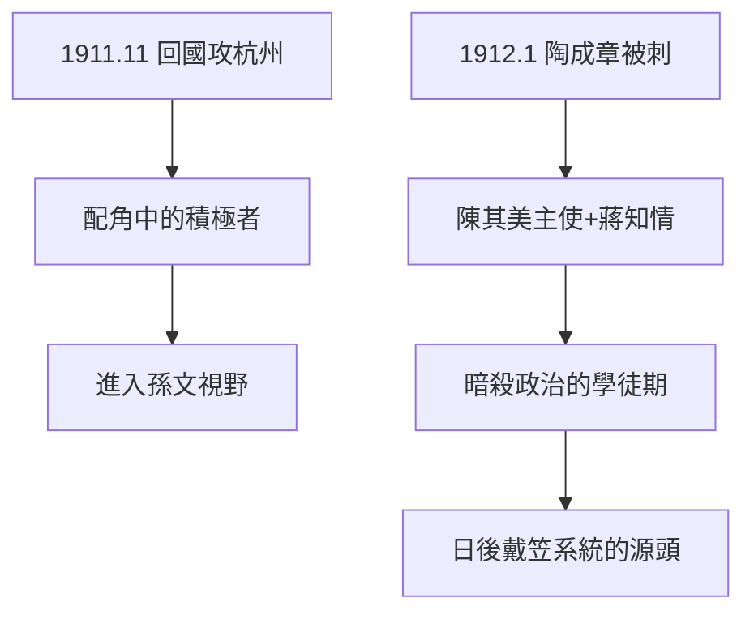

# 1.3 辛亥革命（1911）

## 1911 年 11 月：回國

武昌起義（10 月 10 日）爆發，蔣回國，在上海、浙江活動。11 月率敢死隊攻杭州，被舉為滬軍先鋒（實際是陳其美系統的人馬）。官方史學把他寫成「辛亥功臣」，實際貢獻有限：浙江光復的主力是本地新軍與會黨，蔣是配角之一。

## 陶成章之死（1912）

1912 年 1 月，光復會領袖陶成章在上海被刺殺——主使是陳其美，執行者與蔣有關（蔣的日記與回憶多方印證他知情）。這是辛亥後革命黨內訌的第一滴血：**暗殺作為政治工具**，蔣從陳其美那裡學到手（見 2.1），日後發揚光大（戴笠系統）。

## 辛亥的定位

- 功：參與其事，嶄露頭角，進入孫文視野；
- 過：誇大宣傳的起點——「辛亥功臣」的水分，預示了整個官方傳記的水分；
- 史實：辛亥的主角是新軍、立憲派、會黨，留日學生軍人是配角——蔣是配角中的積極者。

**因果**：日本的軍事訓練（1.2）+ 辛亥的實戰 + 陳其美的暗殺課 = 蔣的政治入門三件套：槍、血、權術。下一章，追隨孫文。
