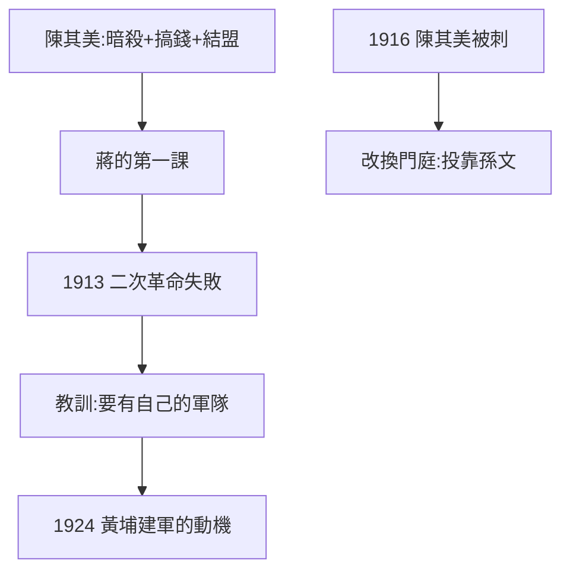

# 2.1 陳其美與青幫（1912–1916）

## 陳其美：真正的導師

陳其美（1878–1916，青幫大佬、滬軍都督）是蔣政治上的第一個老師：教他暗殺（陶成章案，1.3）、教他搞錢（青幫、證券、鴉片）、教他結盟（與袁世凱、與日本人周旋）。蔣對陳終身感恩（陳死後，蔣認陳家為親，提攜陳果夫、陳立夫兄弟——CC 系的由來）。

## 二次革命的失敗（1913）

1913 年宋教仁被刺（袁世凱嫌疑最大），孫文發動二次革命，蔣在上海、南京參戰，敗走日本。這次失敗的教訓：**沒有自己的軍隊，一切免談**——黃埔建軍（2.3）的直接動機。

## 1916：陳其美被刺

袁世凱派人刺殺陳其美於上海。蔣痛失靠山，一度灰心（傳說在上海炒股破產，潦倒度日）。1917 年後靠孫文接濟，重新振作——從「陳其美的人」變成「孫文的人」，改換門庭。

**因果**：辛亥的暗殺學徒（1.3）在此出師，二次革命的失敗教會他建軍。陳其美死後，他帶著青幫人脈與暗殺技術投奔孫文——孫文得到一把刀，刀後來成了主人（第 3 章）。下一節，護法與東征。
