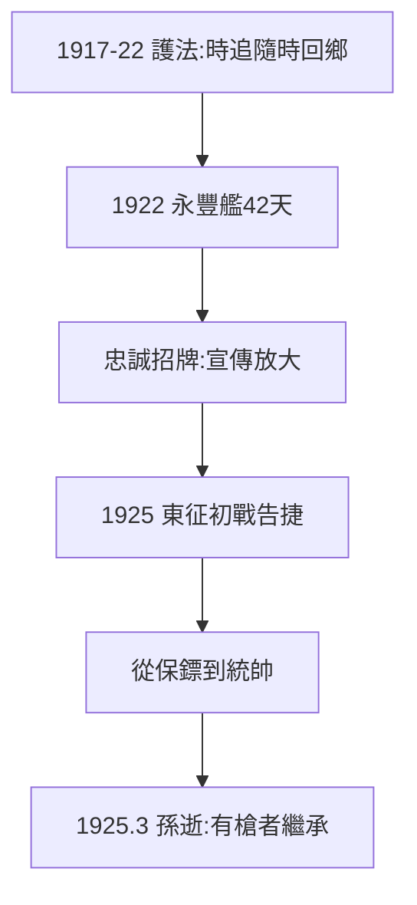

# 2.2 護法與東征（1917–1925）

## 護法運動中的蔣

1917–22 年孫文在廣州護法，蔣時而追隨、時而回鄉（與孫鬧彆扭是常態：嫌孫空談、孫嫌他粗魯）。1922 年陳炯明叛變，蔣登永豐艦護孫 42 天——「永豐艦」是他忠誠的招牌，官方史學大書特書；實際是諸多護衛中的一員，宣傳放大了。

## 東征陳炯明（1925）

1925 年兩次東征，蔣任總指揮，黃埔學生軍初戰告捷。這是他的第一份真正的軍功：從保鏢變成統帥。東征的政治副產品：消滅廣東異己，為北伐（3.1）統一後方。

## 孫文晚年的蔣

1923–25 年，孫聯俄容共、改組國民黨，蔣一度被冷落（赴蘇考察团他不是首選，是替補）。1925 年 3 月孫逝世，蔣在治喪中積極表現——**守靈的人，繼承遺產**（廖仲愷、胡漢民、汪精衛各有心思，蔣有槍）。

**因果**：二次革命的教訓（2.1：要有軍隊）→ 黃埔（2.3）→ 東征 → 統帥地位。孫死時，黨內大佬們有主義、有資歷，蔣有槍——槍贏了。下一節，黃埔。
