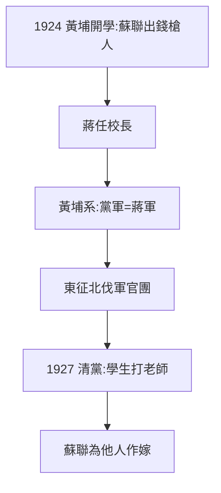

# 2.3 黃埔軍校（1924）

## 1924 年 6 月：黃埔開學

在蘇聯顧問（鮑羅廷、加倫）幫助下，孫文創辦黃埔軍校，蔣任校長。蘇聯出錢、出槍、出教官；共產黨人（周恩來任政治部主任）參與政治工作——國共合作的蜜月，蔣的權力孵化器。

## 黃埔系：私人的軍隊

- 學生對孫文的信仰 + 對校長的效忠——雙重忠誠，後者更實；
- 東征（2.2）、北伐（3.1）的軍官團，清一色黃埔生；
- 學界共識：黃埔是黨軍，更是蔣軍——「校長」成了終身頭銜，黃埔生見蔣喊校長喊到台灣（5.2）。

## 蘇聯的諷刺

蘇聯幫助建黃埔，是為了培養革命軍隊；結果培養出三年後清黨（3.2）反共的蔣。鮑羅廷晚年承認「看走了眼」——但這不是看走眼，是結構：**誰掌握軍校，誰掌握軍隊，誰掌握黨**。孫文懂宣傳，蔣懂這個。

**因果**：二次革命的教訓（2.1）→ 黃埔建軍 → 東征立威（2.2）→ 孫死繼承。1924 年的黃埔，是 1927 年清黨的兵工廠。下一章，北伐與清黨。
