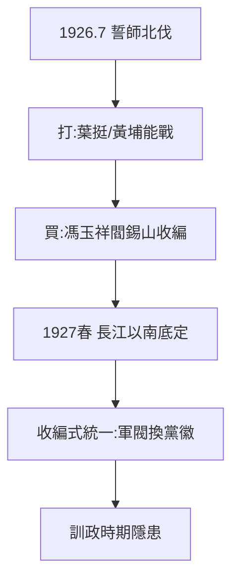

# 3.1 北伐（1926–1927）

## 1926 年 7 月：誓師北伐

國民革命軍 10 萬人，分三路北伐，口號「打倒列強、打倒軍閥」。對手吳佩孚、孫傳芳、張作霖各懷鬼胎，被各個擊破。到 1927 年春，長江以南底定——近代中國第一次接近統一。

## 北伐的真相：打與買

- 打：葉挺獨立團、黃埔學生軍確實能戰（汀泗橋、賀勝橋）；
- 買：更多是收買——馮玉祥倒戈（五原誓師）、閻錫山觀望、唐生智反正，金錢與官位開道；
- 蘇聯顧問（加倫）的參謀作業 + 共產黨的群眾動員（工農運動）是勝利的兩翼——蔣次年就砍掉一翼（3.2）。

## 北伐的歷史地位（平衡評價）

功：結束軍閥混戰的表象，激發民族主義，是一次進步；過：統一是收編式的，軍閥換上黨徽繼續割據——為訓政時期（4.1）的「統一而不統一」埋單。

**因果**：黃埔的槍（2.3）+ 蘇聯的腦 + 共產黨的手 = 北伐勝利。但勝利果實的分配引爆國共決裂——槍要獨吞，手要砍掉。下一節，四一二。
