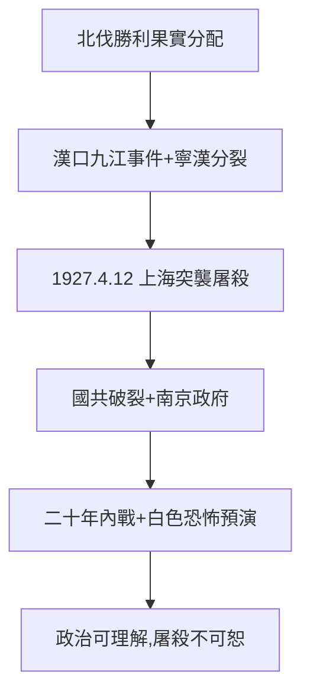

# 3.2 四一二清黨（1927）

## 1927 年 4 月 12 日：上海

蔣介石聯合青幫（黃金榮、杜月笙）、租界巡捕，對上海工人糾察隊與共產黨人突襲繳械、逮捕屠殺。隨後南京、廣州等地跟進，國共破裂。死亡人數：共產黨員與工人數千（一說上萬），白色恐怖開場。

## 為什麼清黨（多重視角）

- 蔣的視角：共產黨的工農運動威脅北伐後方（漢口、九江事件），蘇聯顧問干政，寧漢分裂逼他選邊；
- 共產國際視角：鮑羅廷、陳獨秀的機會主義 + 斯大林的瞎指揮，斷送了合作；
- 結構視角：兩個列寧式政黨無法共存一支軍隊——黃埔（2.3）的槍，只能有一個主人；
- 道德視角：背信 + 屠殺——盟友變屍體，這是蔣一生最黑暗的一頁，無可辯解。

## 清黨的後果

- 短期：蔣得到江浙財閥支持，南京政府成立（1927.4.18）；
- 長期：國共血仇，內戰二十年（1927–49），台灣白色恐怖（5.2）的預演；
- 歷史評價兩極：國民黨史學稱「清黨救國」，中共史學稱「背叛革命」——本書認為：政治邏輯可理解，屠殺手段不可恕。

**因果**：北伐的勝利（3.1）需要獨吞，清黨是獨吞的手段。陳其美的暗殺課（2.1）在這裡畢業——從暗殺個人到屠殺階級。下一節，北伐完成。
