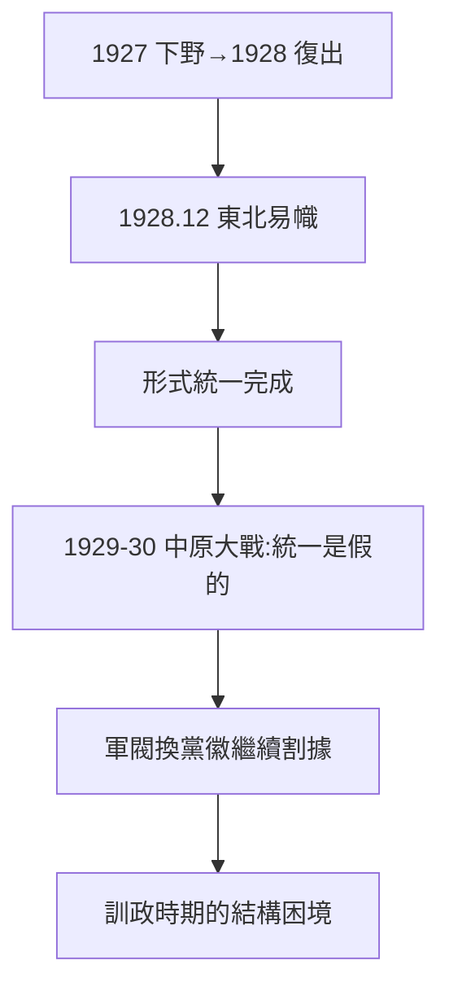

# 3.3 完成北伐（1928）

## 1928：東北易幟

1927 年蔣一度下野（寧漢合流的代價），1928 年復出繼續北伐，張學良 12 月東北易幟——形式統一完成。蔣娶宋美齡（1927.12，宋家+基督教+美國人脈三合一），個人權力登頂。

## 「統一」的含水量

- 馮玉祥、閻錫山、李宗仁各霸一方，中央號令不出長江；
- 1929–30 年中原大戰（蔣 vs 馮閻聯軍），死傷數十萬——統一後立即內戰，證明統一是假的；
- 東北的張學良聽調不聽宣——九一八（1931）的遠因。

## 1928 的定位

官方史學：「完成北伐，統一全國」。學界共識：「形式統一，實質分贓」。蔣從北伐中學到的是：**收買比打仗管用**——這個經驗後來用在剿共（收買軍閥打紅軍）和抗戰（保存實力）上，成敗參半。

**因果**：清黨（3.2）換來財閥支持，財閥支持換來北伐完成，完成是收編式的。1928 年的「統一」是 1930 年內戰的欠條。下一章，黃金十年。
