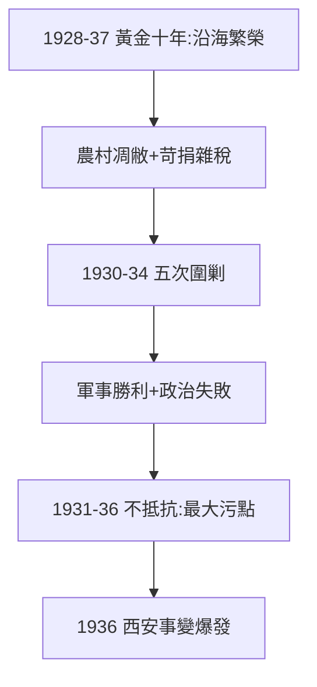

# 4.1 訓政與剿共（1928–1936）

## 「黃金十年」的兩面

1928–37 年稱「黃金十年」：修鐵路、辦教育、幣制改革（1935 法幣）、新生活運動（1934）。沿海城市確有現代化——但僅限沿海，農村依舊，前提是苛捐雜稅。官方史學誇大其詞（「十年建設」），實際是買辦城市的繁榮 + 內地農村的凋敝。

## 五次圍剿（1930–34）

蔣調集百萬大軍五次圍剿中央蘇區，前四次失敗（李德、博古瞎指揮幫了忙），第五次（50 萬兵力、碉堡戰術）得手，紅軍長征（1934–36）。軍事上勝利，政治上失敗：**剿共的每一發子彈，都在為抗戰的缺席做註腳**（東北淪陷 1931，華北危機 1935，中央軍按兵不動）。

## 「攘外必先安內」的辯論

- 蔣的邏輯：不消滅共產黨，抗戰無後方；
- 反對的邏輯：日本是民族敵人，共產黨是黨派敵人，孰先孰後一目了然；
- 學界共識：1931–36 年的不抵抗（九一八、華北）是蔣一生最大的污點之一，西安事變（4.2）是全國共識的爆發。

**因果**：收編式統一（3.3）→ 訓政獨裁 → 剿共優先 → 不抵抗 → 全國憤怒。1936 年的兵諫，是八年積怨的總爆發。下一節，西安。
