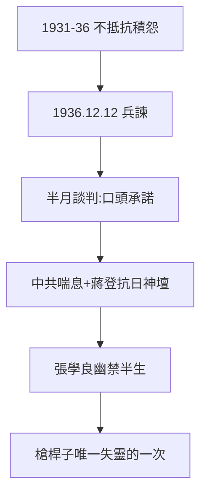

# 4.2 西安事變（1936）

## 1936 年 12 月 12 日

張學良、楊虎城扣押蔣於西安臨潼，逼其聯共抗日。蔣被扣半月，宋美齡、宋子文斡旋，周恩來代表中共談判，最終和平解決：蔣口頭承諾停止內戰、聯共抗日（無書面協議，各說各話）。

## 誰贏了

- 中共：從被剿滅邊緣獲得合法喘息（第二次國共合作），最大贏家；
- 張學良：送蔣回南京後被扣，幽禁半生（1990 年才獲自由）——悲劇英雄；
- 蔣：被迫抗日，但「領袖」地位因禍得福（全國擁戴抗日的領袖）；
- 官方史學曾稱「西安事變是陰謀」，後改口「和平解決是領袖寬大」——兩種說法都遮蔽了真相：**是全國抗日共識綁架了所有人**。

## 歷史的弔詭

蔣一生迷信槍桿子（1.2），西安事變是唯一一次槍桿子失靈——被自己的將領用槍指著。而這次失靈，救了他（逼上抗日神壇，見 4.3），也救了中共。歷史的幽默，莫過於此。

**因果**：剿共優先（4.1）→ 兵諫 → 被迫抗日。蔣一生第一次被槍指著，卻是政治生涯的轉折點——從「剿共領袖」變成「抗日領袖」。下一節，抗戰。
