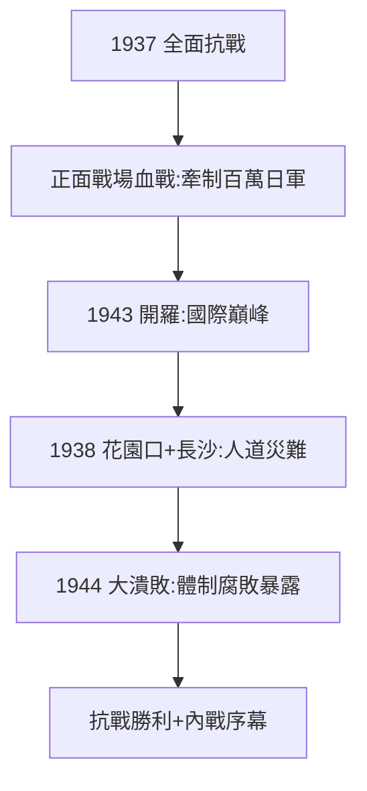

# 4.3 抗戰（1937–1945）

## 1937–45：八年血戰（平衡評價）

功（必須承認）：

- 淞滬、武漢、長沙會戰，中國戰場牽制日軍百萬，付出軍民 2000 萬以上傷亡；
- 國軍是抗戰正面戰場主力（台兒莊、崑崙關），蔣堅持到底（不投降），功不可沒；
- 開羅會議（1943）躋身四強，廢除不平等條約——國際地位巔峰。

過（必須指出）：

- 花園口決堤（1938，89 萬平民死亡）、長沙大火（1938），「焦土抗戰」的人道災難；
- 豫湘桂大潰敗（1944），百萬大軍一潰千里，暴露體制腐敗；
- 保存實力、觀望太平洋戰爭，對中共「限共」「溶共」不斷——抗戰後期重心已轉向內戰準備。

## 抗戰的歷史定位

官方（兩岸）都誇大自己、貶低對方。學界共識：國軍承擔了主要正面作戰（傷亡最大），中共在敵後發展壯大（從 4 萬到 120 萬黨員）；**沒有國軍的血戰，就沒有抗戰的勝利；沒有中共的壯大，就沒有內戰的結局**。兩句話，一個硬幣的兩面。

**因果**：西安事變（4.2）逼上抗日神壇，八年血戰坐實一半、透支一半。抗戰的最大果實（民族領袖）與最大代價（體制掏空）同時成熟——下一章，內戰。
