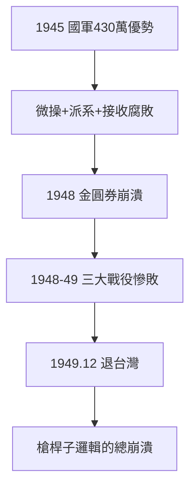

# 5.1 內戰失敗（1945–1949）

## 1945–49：三年崩盤

抗戰勝利時，國軍 430 萬、接收大城市與美械，中共軍隊 120 萬、偏居鄉村。四年後反轉：遼瀋、淮海、平津三大戰役，國軍精銳盡沒，1949 年 10 月中共建政，12 月蔣退台灣。**人類歷史上罕見的極速崩盤**。

## 為什麼崩盤（學界共識）

1. **軍事**：蔣親自指揮到師團，參謀本部形同虛設；派系傾軋（嫡系雜牌），見死不救；
2. **政治**：接收大員「五子登科」（房子、車子、票子、女子、條子），民心盡失；
3. **經濟**：法幣崩潰、金圓券鬧劇（1948），中產階級破產——連支持者都跑了；
4. **對手**：中共土改 + 城市政策 + 蘇聯援助（東北），三管齊下；
5. **美國**：馬歇爾調停失敗，杜魯門棄蔣（「他們自己打輸的」）。

## 1949 的定位

不是單純的軍事失敗，是**體制總崩潰**。蔣的槍桿子邏輯（1.2）走到盡頭：有槍，無民心、無經濟、無盟友——槍也沒了。

**因果**：抗戰的透支（4.3）+ 體制的腐敗 = 三年崩盤。1949 年不是偶然，是 1928 年以來所有欠賬的總結算。下一節，台灣。
