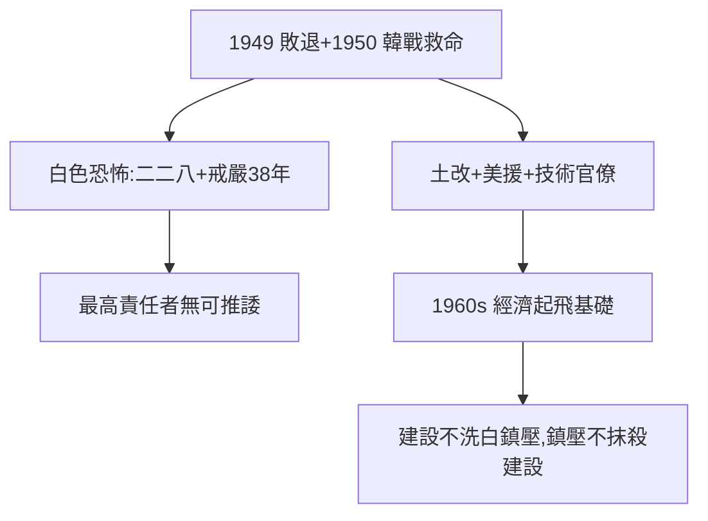

# 5.2 退台與威權（1949–1975）

## 1949：敗退台灣

攜黃金、外匯、故宮文物、百萬軍民退台。韓戰爆發（1950）救了他——杜魯門派第七艦隊，台灣得以苟安。沒有韓戰，很可能沒有後來的故事。

## 白色恐怖 vs 經濟建設（並陳）

黑暗面（必須正視）：

- 二二八（1947，陳儀主政，蔣派兵鎮壓，死傷上萬）——省籍裂痕的起點；
- 白色恐怖（1949–87）：戒嚴 38 年，軍法審判，數千人死刑、數萬人繫獄，連孫立人（抗日名將）都被軟禁 33 年；
- 個人獨裁：總統連任違憲（1960 起）、特務系統（保密局/警總）。

建設面（必須承認）：

- 土地改革（三七五減租、公地放領、耕者有其田）：陳誠執行，成功消滅地主階級，農民翻身——這是中共土改之外的另一條路，且流血最少；
- 美援 + 技術官僚（尹仲容、李國鼎）：進口替代→出口導向，1960 年代經濟起飛的基礎；
- 九年義務教育、戶籍、衛生——現代國家的骨架。

## 平衡評價

台灣的經濟奇蹟，蔣的威權是條件之一（穩定+土改+美援），但不是全部（功勞更多屬技術官僚與台灣人民）；白色恐怖的罪行，蔣是最高責任者，無可推諉。**建設不能洗白鎮壓，鎮壓也不能抹殺建設**——兩句話都要說。

**因果**：內戰的崩盤（5.1）→ 台灣的孤島 → 威權求生。韓戰是運氣，土改是遠見，鎮壓是罪行——三者都是他。下一節，蓋棺。
