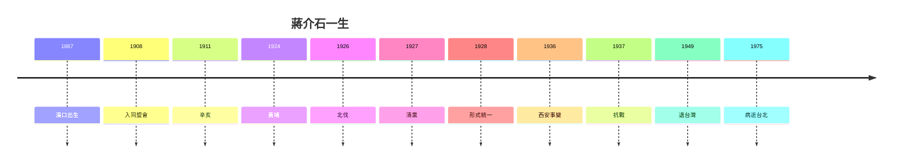

# 5.3 1975 逝世與評價（1975）

1975 年 4 月 5 日，蔣介石病逝台北，享年 87 歲。靈柩暫厝慈湖（遺囑「他日歸葬大陸」——至今未歸）。蔣經國接班，台灣進入後蔣時代。

## 蓋棺：四種評價的並存

| 視角 | 評價 |
|---|---|
| 國民黨官方 | 民族救星、民主長城（神話成分居多） |
| 中共官方 | 偽總統、美帝走狗、抗戰「摘桃」（1980 年代後部分肯定抗戰） |
| 自由主義 | 獨裁者、二二八與白恐的元兇 |
| 發展研究 | 威權現代化的東亞模式之一（與朴正熙、李光耀並列討論） |

## 本書的結論

1. 他是中國統一的追求者，也是分裂的製造者（清黨、內戰）；
2. 他是抗戰的堅持者（不投降是大功），也是抗戰的透支者（腐敗掏空體制）；
3. 他是台灣經濟起飛的條件之一，也是台灣民主遲到的原因之一；
4. 「有槍才有權」（1.2）是他的力量之源，也是他的詛咒——**迷信槍桿子的人，最後被槍桿子的邏輯反噬**（西安被槍指，內戰槍不靈）。

**因果閉環**：溪口的方言（1.1）→ 日本的槍（1.2）→ 陳其美的術（2.1）→ 黃埔的軍（2.3）→ 北伐的勝（3.1）→ 清黨的血（3.2）→ 剿共的執（4.1）→ 西安的槍口（4.2）→ 抗戰的血（4.3）→ 內戰的崩（5.1）→ 台灣的威權與建設（5.2）。**一生的邏輯只有一句：有槍才有權；一生的悲劇也只有一句：有槍，未必有權**。
