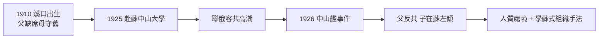

# 1.1 留蘇少年(1910-1927)

1910 年 4 月 27 日（農曆三月十八），蔣經國（乳名建豐）生於浙江奉化溪口。父蔣介石時年 23 歲，尚在日本追隨革命、婚姻離合不定；母毛福梅為元配，不識字，守舊而篤信佛教。經國自幼在祖母與母親的傳統家庭中長大，與父親聚少離多——父子關係的疏離，是理解他一生的起點。

1925 年，15 歲的蔣經國赴蘇聯留學，入莫斯科中山大學（孫逸仙大學）。此行有雙重背景：一是國共第一次合作、聯俄容共的高潮，送子留蘇是政治表態；二是蔣介石正崛起於黃埔，留蘇子弟多為人質性質的交換。經國在蘇聯迅速左傾，加入共青團、共產黨，讀馬列，批判帝國主義，甚至在課堂上批判父親「代表資產階級」。

## 中山艦事件後的變局

1926 年 3 月中山艦事件（蔣介石清黨前奏）後，留蘇學生的處境逆轉：父親在國內反共，兒子在莫斯科罵父親。蘇方把蔣經國當作對蔣介石的籌碼，時而優待、時而冷凍。他先後就讀中山大學、列寧格勒托爾馬喬夫軍政學院，並下工廠（莫斯科電機廠）實習，娶白俄護士芬娜（蔣方良）為妻。這段經歷給他留下三樣東西：流利的俄語、蘇式組織工作的手法（政工、特工、青年團），以及一輩子抹不掉的「親共」嫌疑——這嫌疑在台灣白色恐怖時期，反而成為他必須更反共、更 Cold-blooded 的壓力來源。

## 史觀對照

- **官方敘事**：早年版本多淡化留蘇十二年，或說他「忍辱負重、身在曹營心在漢」，在蘇聯始終心向父親與三民主義。
- **檔案與研究證據**：蔣經國在蘇聯發表的公開信、托派批判文章與入黨紀錄顯示，他 1927–1932 年間是真誠的左傾青年，並非偽裝。近年學者（如浙大、胡佛檔案研究）指出：他的左傾與當時整批中山大學學生的激進化一致，不能簡化為被迫表態。後來返國後的堅決反共，一部分正源於要洗刷這段歷史的政治需要。

## 因果鏈

溪口疏離的父子關係 → 少年留蘇尋找新信仰 → 中山艦事件使之淪為人質 → 左傾既是真誠也是求生 → 學得蘇式政工特工手法 → 為日後在贛南、台灣搞政戰系統埋下技術根源；同時「親共前科」→ 返國後必須以更強硬的反共自證忠誠。
