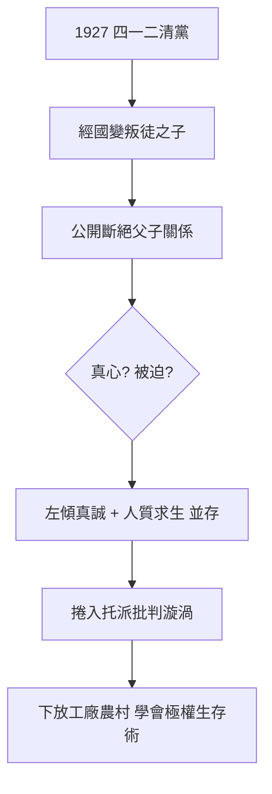

# 1.2 人質與斷絕父子關係(1927-1935)

1927 年 4 月蔣介石發動四一二清黨，國共決裂。莫斯科的蔣經國一夜之間從「革命領袖之子」變成「叛徒之子」。為了自保與表態，他在 1927 年底至 1928 年間連續發表公開信，痛斥蔣介石「背叛革命」，並宣布斷絕父子關係。這封信被《真理報》轉載，一時轟動。

後來的官方說法稱此信係蘇聯逼迫偽造。但現存俄國檔案與當事人回憶顯示：當時中山大學的政治氣氛極端激進，大批學生爭相與「反動家庭」劃清界線，蔣經國的表態符合其一貫左傾邏輯，不能全推給脅迫。當然，脅迫的成分也存在——若不表態，他在肅反氣氛中難有活路。人質的兩難正在於此：真心與求生混在一起，後人難以切割。

## 托洛茨基批判與下放

1930 年代初，蔣經國捲入更危險的漩渦。他曾同情托洛茨基派對史達林官僚化的批判（中山大學內托派影響不小），隨後在史達林整肅托派時又被迫轉向、參與批判托派。這種反覆在極權體制下是常態：今天批判別人，明天被人批判。

1931–1935 年，他被下放到工廠與農村（烏拉爾重型機械廠等），當車工、副廠長，歷經第一個五年計畫的混亂與饑荒，也親歷聯共黨內清洗的恐怖。他學會了計畫經濟的語言（動員、超額完成、揪出破壞分子），也學會了在恐怖中生存：緊跟風向、公開檢討、與可疑者切割。這套生存術，後來被他完整帶回中國。

## 史觀對照

- **官方敘事**：「經國先生在蘇聯受盡折磨、堅貞不屈，斷絕父子關係聲明係蘇共偽造。」
- **檔案與研究證據**：俄國解密檔案、米夫（Pavel Mif）報告與同學回憶（如俞秀松、王明系人馬記述）表明，聲明至少經他本人同意或親筆；其托派立場的搖擺亦有文字可考。學界共識是：不必糾結「真心或被迫」的二分法——在史達林體制下，真心與被迫本就一體兩面。重點是這段經歷塑造了他的統治技術，而非道德審判。

## 因果鏈

四一二清黨 → 人質身價暴跌 → 以斷絕關係換取生存 → 捲入史達林—托洛茨基鬥爭 → 下放學會計畫動員與清洗邏輯 → 內化極權組織技術 → 返國後反共的激烈程度，與在蘇聯受的屈辱與嫌疑成正比。
