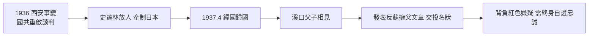

# 1.3 西安事變與歸國(1936-1937)

1936 年 12 月西安事變（張學良、楊虎城扣蔣）改變了蔣經國的命運。蔣介石獲釋後國共重啟談判，史達林出於聯合抗日、牽制日本的戰略考慮，決定放蔣經國回國。1937 年 4 月，蔣經國攜妻蔣方良、子蔣孝文返抵杭州，結束十二年留蘇生涯。父子在溪口相見，抱頭痛哭——但裂痕並未真正癒合，父子此後一生既依賴又猜忌。

歸國的時機耐人尋味：恰在抗戰前夕，蘇聯需要蔣介石抗日，蔣介石需要蘇聯軍援，兒子是最好的信物。所謂「虎口餘生」，實為大國交易的籌碼交割。蔣經國回國後立即發表《我在蘇聯的生活》等文，痛斥蘇聯、表態反共、擁護父親，等於遞交投名狀。

## 歸國的代價：永遠的忠誠考試

留蘇十二年使他在國民黨內永遠背著「紅色嫌疑」。CC 系、軍統系都視之為異己。為了過關，他必須比誰都反共、比誰都效忠父親。這解釋了他此後三十年的行為模式：在贛南搞「新式保甲」、在上海打老虎、在台灣搞政工特務——每一項都是向父親與黨內元老證明「我已新生」的忠誠展演。

同時他也帶回了真正的本事：俄語（可直接與蘇聯顧問打交道）、蘇式幹部學校經驗、青年動員與工廠管理見聞。抗戰初期的國民黨正缺這類「懂組織的年輕人」，他很快被派往江西（見第 2 章）。

## 因果鏈

西安事變 → 國共蘇三角交易 → 人質交割歸國 → 以反蘇反共文章換取信任 → 紅色前科轉化為終身忠誠焦慮 → 此後一切強硬作為（贛南、上海、台灣政工）皆可視為這場考試的延續。
