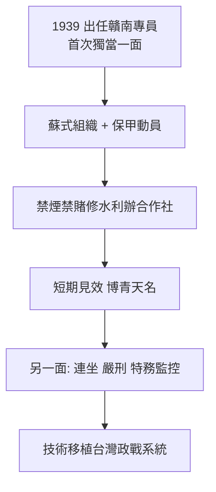

# 2.1 贛南新政(1939-1945)

1939 年，蔣經國出任江西省第四行政區督察專員兼贛縣縣長（人稱贛南專員），實際管轄贛南十餘縣。這是他第一次獨當一面。贛南地瘠民貧、土匪橫行、共產黨游擊隊出沒，正好做實驗。

他推行所謂「贛南新政」：

- **政治**：新式保甲、戶口清查、幹部學校（仿蘇式訓練班），建立綿密的基層控制網；
- **經濟**：禁煙（鴉片）、禁賭、禁娼，推廣合作社、墾荒、修水利，創辦公營事業以平抑物價；
- **社會**：掃盲、新生活運動、青年訓練，親自下鄉，赤腳與農民座談。

短期內贛南面貌確有改善，土匪減少、稅收增加，他博得「蔣青天」名聲。這是他一生親民作風的起點——也是作秀政治的起點：下鄉、與民同樂、微服出巡，後來在台灣故技重施。

## 批判性檢視

贛南新政的另一面是濃厚的威權與蘇式色彩：保甲連坐、思想審查、特務監控共黨嫌疑，青年團式的動員不容異議。禁煙禁賭靠的是嚴刑峻罰乃至槍決。所謂建設，多靠攤派與強制勞動。它更像一場「開明專制的櫥窗實驗」：在戰時後方小範圍可行，一旦放大到全國即破產（上海即明證）。

## 史觀對照

- **官方敘事**：贛南是「三民主義模範區」，證明經國治國有方、親民愛民。
- **學界研究**：費正文（John Fitzgerald）、丘立本等指出，贛南新政本質是戰時動員體制 + 蘇式組織技術的混合體，成效被誇大，且高度依賴戰時特權與父親庇蔭，不具可複製性。其控制技術（保甲、幹校、特務）後來直接移植到台灣的政戰與救國團系統。

## 因果鏈

留蘇學得組織術 → 贛南小範圍實驗 → 以強制動員換取短期績效 → 贏得父親信任與親民名聲 → 同時固化「動員 + 特務」治理模板 → 上海放大即失靈，台灣沿用即白色恐怖的基層網絡。
