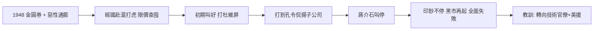

# 2.2 上海打虎(1947-1949)

1947–1948 年，國民政府幣制改革發行金圓券，蔣經國以「上海經濟管制督導員」身份進駐上海「打老虎」：查囤積、封倉庫、槍決投機商、限價凍結，揚言「只打老虎、不拍蒼蠅」。初期雷厲風行，上海灘為之震動，杜月笙之子杜維屏亦被查辦，一時輿論叫好。

不到三個月即徹底失敗。原因不在他不夠狠，而在結構：

- 財政上，前線軍費黑洞不堵，印鈔不停，凍結物價違反 $MV = PY$ 的基本約束，黑市必然再起；
- 政治上，打到孔宋家族（揚子公司孔令侃案）即被叫停，蔣介石親自下令收手——權貴資本主義的體制不容真打；
- 經濟上，金圓券發行失控，月通膨以倍計，任何稽查都只是表演。

## 不妖魔化：承認其脈絡

公允地說，上海打虎並非個人貪腐或作秀單一動機。當時接收日偽資產的貪腐確實天怒人怨，民間期待有人整頓；蔣經國親自住簡陋招待所、不拿紅包，在一片腐敗中確屬異類。他的失敗是體制性失敗的縮影：一個不改革權貴結構、不約束印鈔的政權，派太子去打老虎，注定虎沒打成、自己賠上信用。

## 史觀對照

- **官方敘事**：「經國先生大公無私、打虎不避權貴，惜功敗垂成，令人扼腕。」
- **檔案與研究證據**：央行檔案、美方報告（司徒雷登電文）與學者（易勞逸 Lloyd Eastman）研究均指出，打虎是蔣介石默許的轉移焦點之舉，孔宋案叫停證明體制自我保護優先。打虎的真正遺產是教訓：蔣經國從此學會——經濟不能靠運動式嚴打，而要靠技術官僚與美援體制（此即來台後的轉向）。

## 因果鏈

內戰軍費黑洞 → 惡性通膨（ $P$ 飆升）→ 派太子打虎轉移民怨 → 觸及權貴即被叫停 → 限價違背貨幣約束而崩盤 → 打虎失敗 → 經國習得「運動式治理無用論」→ 來台後改倚李國鼎、孫運璿等技術官僚。
