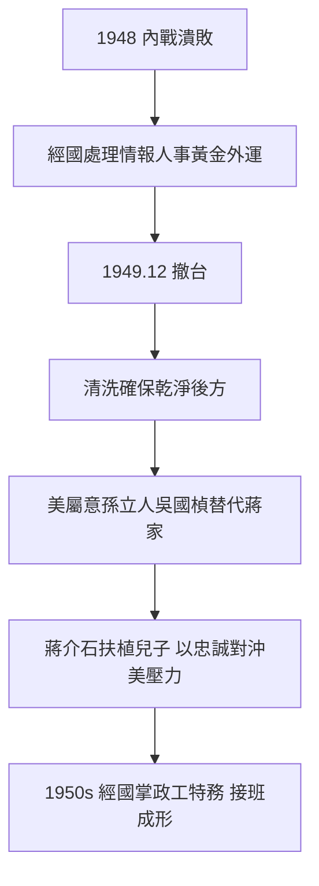

# 2.3 內戰失敗與來台佈局(1948-1949)

1948 年底至 1949 年，國共內戰大勢底定。蔣經國的角色從經濟轉向軍事特務：協助父親處理軍隊人事、情報與黃金外運。關於「運台黃金」的數字至今爭議（中央銀行黃金約 300 餘萬兩之說），但無爭議的是：運台的真正資產是人——技術官僚、軍隊骨幹、故宮文物與檔案，以及美援接續的資格。

1949 年 12 月，蔣經國隨父撤台。此前他在上海、贛州處理潰退事宜，傳聞涉及處決共黨嫌疑與整肅異己。這段歷史細節多湮沒於戰亂，但模式清楚：潰退即清洗，確保台灣成為「乾淨的後方」。

## 來台佈局：為何是他接班

蔣介石選經國接班，並非即時決定，而是 1949–1950 年間逐步成形：長子身份、留蘇忠誠考試通過、贛南上海歷練、掌握青年與特務系統。更重要的是，美國一度屬意孫立人、吳國楨等「自由派」替代蔣家，蔣介石亟需一個絕對忠誠且能與美周旋的接班人——兒子最可靠。經國 1950 年代掌握總政治部與救國團，正是接班佈局的第一步（見第 3 章）。

## 因果鏈

內戰潰敗 → 黃金人力文物撤台 → 潰退清洗 → 美國尋求蔣家替代者 → 蔣介石加速扶植兒子 → 經國掌握槍桿子與筆桿子（政工 + 青年）→ 威權接班結構在 1950 年代初即已澆鑄。
