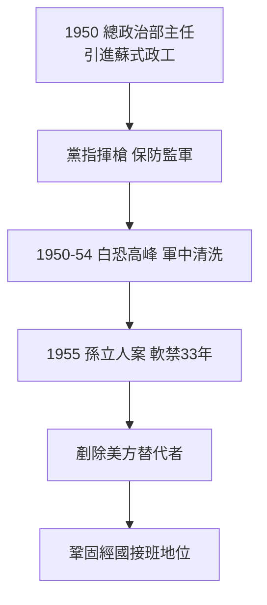

# 3.1 總政治部與白色恐怖(1949-1960)

1950 年，蔣經國出任國防部總政治部主任（後改稱總政戰部），全面引進蘇式政工制度：軍隊設政工人員，實行「黨指揮槍」、監軍與思想考核。這套制度源自他在蘇聯軍政學院的見聞，經贛南試驗，完整移植到台灣軍隊。與之配套的是情報系統的重組：與毛人鳳、唐縱、彭孟緝等人合作，整肅軍中異己。

1950 年代白色恐怖的高峰（1950–1954），全台約 2000 人遭處決、上萬人繫獄，軍中是重災區。蔣經國的責任不能以「奉父命」一筆勾銷：總政治部是軍中清洗的執行樞紐之一，保防、監察、人事三線都經其手。孫立人案（1955）最具指標性：孫立人（留美派、受美信任）部屬郭廷亮「兵變」案，經調查局擴大為匪諜案，孫遭軟禁 33 年。此案剷除了美方可能的替代者，鞏固了蔣經國的接班地位，軍方檔案與近年研究多指向政治整肅大於真實叛亂。

## 史觀對照

- **官方敘事**：白色恐怖是「反共保台的必要之惡」，經國僅負責政工教育，與抓人殺人無關。
- **促轉會、檔案與研究證據**：促轉會調查報告、國防部軍法檔案與受難者口述顯示，總政治部參與審查、保防與判決會稿；孫立人案經監察院（陶百川）調查與學者（陳錦昌、 pipe 研究）認定為冤案。學界共識：蔣經國是白色恐怖體制的核心建構者與受益者之一，而非旁觀者。承認冷戰反共的時代脈絡，不等於免除個人與體制的責任。

## 因果鏈

留蘇政工技術 → 1950 年移植國軍 → 保防監軍網絡 → 白恐軍中清洗 → 孫立人案剷除競爭者 → 接班障礙掃除 → 威權一元體制的軍事支柱完成。
