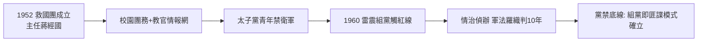

# 3.2 救國團與雷震案(1952-1960)

1952 年成立的中國青年救國團（主任蔣經國），表面是青年育樂組織，實為黨外編的政戰系統：校園設團務、軍訓教官兼情報、寒暑訓營篩選忠誠青年。它繞過國民黨黨機器，直屬蔣經國，形成「太子黨」的青年禁衛軍。救國團 + 總政治部 + 情報局，構成 1950–60 年代蔣經國的三隻手。

1960 年雷震案是這隻手伸向黨外的標誌。雷震（《自由中國》發行人、外省自由派）主張反對黨、批評蔣介石三連任，觸及黨禁紅線。當局以「知匪不報、為匪宣傳」罪名逮捕雷震，判刑 10 年，《自由中國》停刊。本案由蔣經國主導的情治系統偵辦、蔣介石親自批示，軍法審判不公開。雷震日記與近年檔案證實：罪名是羅織，真正原因是組黨觸碰一元體制底線。

同期的余登發案（1979，見 4.2）可視為雷震案的翻版：本省菁英一旦串連組黨，即以匪諜罪名打擊。兩案連起來看，黨禁報禁不是抽象政策，而是蔣經國系統親手執行的日常業務。

## 史觀對照

- **官方敘事**：雷震「通匪有據」，救國團「純為青年服務、無政治功能」。
- **檔案與研究證據**：雷震案判決書、蔣介石日記批示與胡適—雷震通信顯示，本案政治動機明確；薛化元、陳儀深等學者研究與促轉會平復公告已認定為政治冤案。救國團檔案亦顯示其政戰考核與情報蒐集功能。官方說法與證據不符。

## 因果鏈

總政治部掌軍 → 救國團掌青年 → 情治掌異議 → 雷震組黨 → 以匪諜罪名撲殺 → 自由派消音 → 一元體制底線（黨禁 = 反共國策）確立 → 此後二十年黨外只能在底線外游擊。
