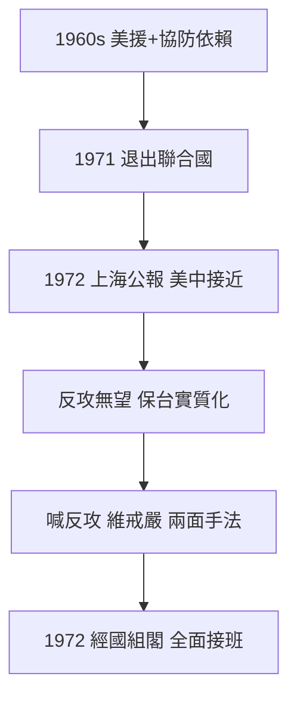

# 3.3 退出聯合國與中美關係(1960-1972)

1960–1970 年代，蔣經國以國防部副部長、部長、行政院副院長身份，深度參與對美關係。關鍵轉折有三：1961–1971 年聯合國代表權保衛戰失敗（1971 年退出聯合國）、1969–1972 年尼克森—季辛吉聯中制蘇、1972 年《上海公報》。台灣從「自由世界前哨」淪為美中交易的籌碼。

蔣經國對美態度矛盾：一面依賴美援與協防（沒有第七艦隊就沒有台灣），一面痛恨美國干涉內政、同情自由派與黨外。1965 年彭明敏案、美方學界援救彭明敏，都加深這種猜忌。他延續父親「反攻大陸」的修辭，但實際已轉向「保台」——1960 年代後期反攻已無可能，喊反攻只是維持戒嚴與動員的藉口，這一點他心知肚明。

1972 年蔣介石病重，蔣經國出任行政院長（1972–1978），全面接班。此時的中美關係已預示 1979 年斷交危機（見 4.2），而他應對危機的方式——以內部高壓（美麗島）對沖外部孤立——在此十年已見端倪。

## 因果鏈

依賴美援 → 美中接近 → 國際孤立（退出聯合國）→ 反攻神話破產 → 以反攻修辭維持戒嚴正當性 → 經國以副手身份習得「外危內壓」模式 → 1972 年接班 → 1979 年斷交—美麗島危機的預演完成。
