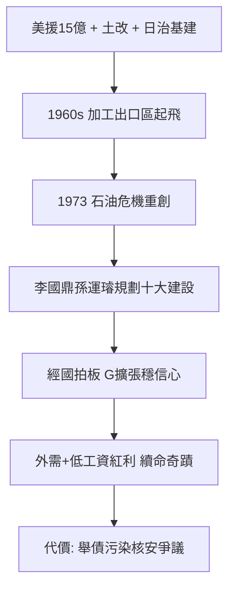

# 4.1 十大建設與石油危機(1972-1978)

1972 年蔣經國組閣，1975 年蔣介石病逝、嚴家淦繼任總統，實權已在經國手中。1973–1974 年第一次石油危機重創以出口為導向的台灣經濟，1974 年更爆發「榮星花園」等官商勾結疑雲。經國政府推出「十大建設」（1974–1979）：中山高、桃園機場、台中港、蘇澳港、鐵路電氣化、大鋼廠（中鋼）、大造船廠、大煉油廠、石化（中油）、核電廠，總投資逾 2000 億台幣。

## 結構因素，而非個人英明

官方把十大建設說成「經國遠見、創造經濟奇蹟」。對照證據：

- **美援與土改打底**：1950–65 年美援約 15 億美元 + 三七五減租、公地放領、耕者有其田，把地租轉化為工業資本（台泥、台紙等民營化），這才是起飛的地基，與經國無直接關係；
- **日治遺產**：鐵路、電力、水利、戶籍與基層行政網，戰後直接沿用；
- **技術官僚**：李國鼎、孫運璿、趙耀東規劃執行，經國的角色是拍板與擋政治干擾，而非設計；
- **國際分工**：美日產業外移 + 越戰特需 + 加工出口區（高雄 1966），台灣以低工資女工承接勞力密集製程，用 $Y = C + I + G + NX$ 的語言說，是 $NX$ 的外需拉動，不是領袖拉動；
- **代價**：十大建設舉債、中鋼中船長期虧損、石化與核電埋下污染與安全爭議，1979 年第二波油危機即暴露脆弱性。

公允評價：十大建設確為正確的反景氣投資（凱因斯式 $G$ 擴張），穩定了 1970 年代中期的信心；但「經濟奇蹟」的神話把結構紅利記在個人帳上，是倒果為因。

## 史觀對照

- **官方敘事**：「沒有經國就沒有十大建設、沒有經濟奇蹟。」
- **學界研究（瞿宛文、安超、若林正丈）**：奇蹟 = 美援 + 土改 + 日治基礎設施 + 冷戰分工 + 技術官僚 + 壓低工資與環保的威權紅利。經國的貢獻在於授權技術官僚、不分贓十大建設款（相對廉潔），而非英明設計。

## 因果鏈

石油危機 → 出口重挫 → 技術官僚提反景氣基建 → 經國政治拍板 → 短期穩信心、長期墊高重化工業 → 結構紅利被收割為個人神話 → 神話反過來正當化威權（拚經濟所以要穩定）。
